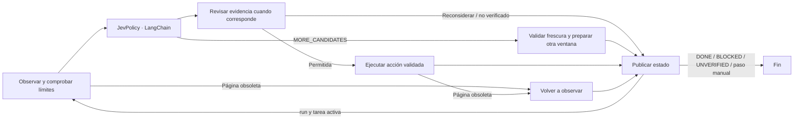

# AgentRun

Sistema de agentes de navegador basado en [browser-use/jev-ultrafast](https://github.com/browser-use/jev-ultrafast), con **Jev para ejecutar acciones**, **LangGraph** para controlar el flujo y un **supervisor LangChain opcional** para interpretar objetivos y comprobar resultados. El coordinador conserva el plan, programa sus tareas y reanuda el trabajo.

## Inicio rápido

Requisitos: Python 3.12+, [uv](https://docs.astral.sh/uv/) y Chrome conectado mediante Browser Harness.

```bash
cd AgentRun
uv sync --locked
uv run agentrun
```

El inspector se abre en **http://127.0.0.1:8766**. Permite elegir una acción, ejecutarla por separado o avanzar automáticamente. El nombre `jev` sigue disponible por compatibilidad.

Esta instalación incluye un `.env` local ignorado por Git que apunta al archivo de entorno externo indicado al crear el proyecto. Las claves no se copian al repositorio. Para configurar otra instalación, crea un `.env` con una referencia:

```dotenv
AGENTRUN_ENV_FILE=/ruta/absoluta/al/archivo/.env
```

También puedes usar `cp .env.example .env` y completar sus variables, o seleccionar un archivo directamente:

```bash
uv run agentrun --env-file /ruta/al/.env
uv run agentrun run --env-file /ruta/al/.env \
  --url https://en.wikipedia.org/wiki/Main_Page \
  --goal 'Find and open the Wikipedia article about Gödel’s incompleteness theorems.'
```

`python -m agentrun` ofrece la misma interfaz. Si Chrome necesita conectarse, ejecuta `uv run browser-harness --doctor` y sigue las indicaciones de Browser Harness.

## Modelos y configuración

| Variable | Uso |
| --- | --- |
| `TYPESAFE_API_KEY` | Credencial del modelo principal Jev en TypeSafe |
| `TYPESAFE_MODEL` | Modelo de decisión; predeterminado `jev-latest` |
| `TEXT_MODEL_API_KEY` | Credencial del auxiliar que genera valores para campos |
| `TEXT_MODEL_BASE_URL` | Endpoint compatible con OpenAI del auxiliar |
| `TEXT_MODEL` | Modelo auxiliar configurado en tu archivo de entorno |
| `TEXT_MODEL_REASONING` | `none` desactiva reasoning cuando el proveedor lo admite |
| `VERIFICATION_API_KEY`, `VERIFICATION_BASE_URL`, `VERIFICATION_MODEL`, `VERIFICATION_REASONING` | Configuración opcional del revisor de evidencia; cada valor vacío reutiliza su equivalente `TEXT_MODEL_*` |
| `SUPERVISOR_API_KEY`, `SUPERVISOR_BASE_URL`, `SUPERVISOR_MODEL`, `SUPERVISOR_REASONING` | Configuración del supervisor opcional; cada valor vacío reutiliza la configuración efectiva del revisor |
| `AGENTRUN_ENV_FILE` | Archivo externo que se carga desde la CLI o `load_environment()` |
| `TYPESAFE_DEMO_PORT` | Puerto del inspector; predeterminado `8766` |

Las variables ya presentes en el proceso prevalecen. Sin `--env-file`, se carga primero `.env` del directorio actual y después el archivo referenciado; los valores locales prevalecen sobre el archivo externo. Con `--env-file` se carga únicamente el archivo seleccionado. Importar el paquete no carga credenciales ni abre el navegador.

Jev conserva su protocolo nativo de TypeSafe: una sola solicitud contiene la operación y las posibles selecciones de elementos. Solo se consume el objetivo correspondiente a la operación elegida. El auxiliar se llama únicamente para `TYPE_TEXT`; no toma decisiones de navegación.

Los botones de icono sin nombre pueden tomar la etiqueta visible de su fila cuando esta contiene un único control. La búsqueda queda acotada a esa fila, respeta los nombres explícitos y conserva `aria-pressed` para distinguir el estado de los botones conmutables.

Las instrucciones de decisión distinguen seleccionar opciones de confirmar un panel de filtros: piden confirmar el panel actual cuando sus opciones estén listas, continuar con los demás filtros y comprobar el resultado visible después de confirmar.

Para límites numéricos, las instrucciones piden comparar el importe completo y su unidad, conservar la magnitud al interpretar separadores y seguir buscando si la opción exacta no está disponible. Un límite más estricto no sustituye al solicitado salvo que el objetivo permita una alternativa. Esta guía no garantiza la precisión del modelo; el valor aplicado sigue necesitando verificación.

En el modo directo, el agente revisa por defecto las acciones que pueden abandonar o confirmar una región, las transiciones relevantes y las conclusiones `DONE`/`BLOCKED`. El revisor recibe el objetivo, hechos observados con referencias, cambios recientes y requisitos pendientes. Utiliza peticiones y contadores independientes del auxiliar de escritura, aunque puede compartir su configuración de proveedor. La lista de requisitos expresa resultados esperados, no una secuencia de navegación. Una revisión semántica puede equivocarse: la validez de sus referencias y formato no demuestra que haya interpretado exhaustivamente el objetivo.

Desplazar una región fuera de la vista o recuperar una propuesta cancelada no fuerza otra revisión. Las aperturas con `expanded=false` pueden omitirla si el botón está observado como no submit y no hay otro control expandido. Los botones de confirmación, enlaces, cierres y controles ambiguos conservan la revisión. Una navegación real o un ciclo detectado siguen activándola; el snapshot posterior a cada acción y las guardas de frescura no cambian.

Cada requisito distingue `satisfied`, `unsatisfied` y `unknown`. Una confirmación rechazada no se ejecuta y se retira de los candidatos únicamente mientras persista el mismo estado observado. Jev vuelve a elegir sobre la observación actual con la evidencia del rechazo. El revisor no elige selectores ni ejecuta acciones. Los valores inicialmente correctos pueden confirmarse sin modificarlos. Tres revisiones sin resolver el mismo estado detienen la tarea como `unverified`. Si Jev repite una conclusión terminal rechazada sin hechos ni ejecuciones nuevos, se detiene como `unverified` sin volver a pagar esa revisión. El presupuesto predeterminado es de 24 llamadas de revisión y comparte el límite temporal de la ejecución. `Agent(..., max_verification_calls=...)` ajusta ese presupuesto; `verifier=callable` permite un comprobador inyectable para pruebas o contratos específicos.

El proveedor de revisión debe admitir salidas JSON con esquema estricto. El esquema limita las referencias a los hechos realmente enviados; el validador comprueba además su pertenencia y la conservación de los requisitos. Una respuesta inválida detiene la ejecución como no verificada antes de ejecutar la acción pendiente.

## Candidatos y reconsultas

El lector conserva un inventario acotado de controles observados. Cada petición Jev ofrece una ventana con un máximo de **80 elementos**, **12 opciones por desplegable**, **250 acciones de navegador** y **96 KiB de JSON UTF-8**. El reparto alterna regiones y tipos de operación para que un desplegable extenso deje espacio a otros controles. El tamaño se comprueba sobre el cuerpo exacto enviado, incluido el objetivo, el historial y todas las cabezas de selección.

Cuando ninguna acción ofrecida permite avanzar, Jev puede elegir `MORE_CANDIDATES` para consultar otra ventana. LangGraph consume esa decisión y presenta candidatos pendientes, sin emitir entradas de navegador ni llamar al auxiliar de texto. Cada ventana evaluada añade una decisión Jev; el inspector y la CLI muestran por separado decisiones, intentos HTTP y reconsultas. Las lecturas de frescura conservan la ventana y los cambios relevantes de página invalidan el recorrido anterior.

`candidate_coverage` distingue la cobertura de la ventana, el progreso acumulado y los límites de extracción. Por defecto se inspeccionan como máximo 5000 controles y 5000 opciones por inventario, con hasta 32 regiones y un grupo residual. El recorrido está limitado a 120 ventanas, 120 decisiones y 300 segundos de ejecución; las reconsultas consumidas no se reinician al cambiar la página. Se conservan además las 60 acciones máximas de navegador. Los límites se configuran al crear el agente:

```python
from agentrun import Agent, CandidateLimits

limits = CandidateLimits(max_nodes=60, max_options_per_select=8, max_windows=40)
agent = Agent(url, goal, candidate_limits=limits)
```

Un inventario incompleto no prueba que un elemento no exista. Esta implementación permite consultar lo observado y omitido por el presupuesto. Las regiones desplazables observadas tienen objetivos propios para `SCROLL_UP` y `SCROLL_DOWN`, dentro de la misma petición TypeSafe. Descubrir controles fuera del viewport requiere seleccionar esa región, ejecutar un desplazamiento y volver a observar. `MORE_CANDIDATES` no desplaza ni descubre contenido nuevo. Los adaptadores de shadow DOM/iframes y las continuaciones de extracción de CS04 siguen pendientes. Las cuotas están comprobadas con páginas sintéticas y proveedores simulados; no son mediciones de precisión del proveedor. Detalles: [CS01](Specs/candidates%20selector/01_presupuesto_y_recorte.md).

## Flujo del agente



`Agent.graph` es un `CompiledStateGraph` real. `run()` transmite un estado por turno completo y el grafo decide cuándo continuar o terminar. `command("tick")` ejecuta un turno; `command("predict")` pausa antes de actuar; `command("act", agent.decision_body())` consume esa decisión. El cuerpo incluye el fingerprint y la identidad de decisión, inventario, ventana y selección; un fingerprint de página por sí solo no distingue dos ventanas. En un cliente remoto, conserva esos campos de la respuesta `predict` y envíalos con `act`. Los adaptadores `JevPolicy` y `TextValue` son `RunnableLambda` de LangChain, compatibles con callbacks y configuración.

El grafo directo está vinculado a una sesión de navegador y no debe usarse concurrentemente. Ese modo no configura persistencia/reproducción de checkpoints ni reintentos sobre nodos que ejecutan acciones. Cada decisión se consume antes de actuar y la ejecución se registra antes de observar el resultado. La recuperación de una página obsoleta conserva ese registro. Los presupuestos originales y la detección de falta de progreso siguen activos.

Si cambia la página durante una decisión o revisión, la recuperación informa a Jev y al revisor de qué propuesta quedó pendiente y de si llegó a ejecutarse. Una propuesta cancelada nunca se registra como acción realizada. El aviso temporal se retira tras una ejecución y observación que resuelven esa recuperación, o cuando la navegación cambia su ámbito; los criterios de la tarea y el contexto del elemento se conservan. Un desplazamiento ajeno no borra una propuesta pendiente. Esto permite volver a localizar un elemento desplazado por contenido dinámico. Si Chrome pierde la sesión CDP, las lecturas pueden reconectarse dos veces a la misma pestaña existente; se descarta la decisión anterior y se vuelve a observar. Los comandos de entrada no se repiten.

Después de cada acción de navegador —clic, escritura, selección, desplazamiento o espera— se obtiene un **snapshot nuevo del DOM**, incluso si la URL y el fingerprint no cambian. Si un clic no produce ningún cambio observable, ese mismo objetivo queda temporalmente excluido mientras la página siga igual y Jev recibe el motivo; vuelve a estar disponible cuando cambia el estado. Ese snapshot actualiza los elementos disponibles para la siguiente decisión. `Agent.snapshot()` devuelve el último estado observado; las capturas de imagen siguen siendo opcionales.

Jev puede elegir `RELOAD` para recargar la pestaña actual si la observación indica que la página lleva demasiado tiempo cargando o no puede avanzar. La recarga se ejecuta una sola vez y va seguida de un snapshot nuevo; Jev no debe usarla para repetir un envío cuyo resultado sea incierto.

Las observaciones transitorias permiten relecturas acotadas, sin entradas de navegador ni llamadas al modelo. Un DOM vacío aislado no provoca inmediatamente una decisión terminal. Se publican disponibilidad y motivos de cobertura por separado: un iframe no soportado no demuestra que un control concreto esté ausente. El historial añade diferencias observadas de valores, selección, contexto y navegación. Que una región deje de observarse no demuestra que sus cambios hayan sido aplicados. Los ciclos se detectan con una huella de progreso independiente de la frescura y de las referencias de evidencia: ignora identificadores DOM efímeros y geometría, pero conserva valores, selección, contexto, orden y desplazamiento. El aviso de ciclo conserva los criterios de la tarea delegada.

El revisor recibe además un registro compacto de hasta 60 acciones ejecutadas, separado de los diez pasos con efectos recientes. Así conserva una confirmación antigua aunque hayan intervenido varios desplazamientos. Los textos y contextos están acotados y los recortes se declaran; haber ejecutado una acción sigue requiriendo una postcondición observada para demostrar su resultado.

La cobertura incluye detalles acotados de visibilidad de los hosts no soportados, sin leer su contenido. Al navegar se conserva un máximo de 16 hechos del origen, incluido el enlace observado y su posición entre los controles disponibles. Esa evidencia se marca como histórica: permite contrastar origen y destino, pero no demuestra por sí sola el orden global de resultados ni el éxito de una acción.

`done` con `verification.status=satisfied` significa que la revisión semántica encontró evidencia para los requisitos. `unverified` significa que faltó evidencia, configuración, presupuesto o una respuesta válida del revisor. La CLI devuelve cero únicamente con revisión satisfecha; bloqueos y resultados no verificados devuelven 2. `verification=False` conserva el modo de selección sin revisor para pruebas aisladas y compatibilidad: un `DONE` en ese modo no valida el resultado y la CLI no lo presenta como éxito.

## Uso como biblioteca

```python
from agentrun import Agent
from agentrun.config import load_environment

load_environment()  # Usa .env y su posible referencia externa.
with Agent(
    "https://en.wikipedia.org/wiki/Main_Page",
    "Find and open the article about Gödel’s incompleteness theorems.",
) as agent:
    for state in agent.run(config={"tags": ["research"]}):
        pass  # Los logs muestran las acciones y sus descartes.
    print(state["status"])
```

`from jev_ultrafast import Agent` continúa funcionando. Los ejemplos y scripts originales utilizan el mismo agente adaptado; al ejecutarlos directamente carga las variables con `uv run --env-file /ruta/al/.env python examples/run.py ...`.

Al salir del bloque `with`, la pestaña de trabajo **permanece abierta**, también si la tarea termina bloqueada, sin verificar o con una excepción. Se libera la sesión de control sin cerrar Chrome. El inspector conserva igualmente la pestaña al reiniciar una tarea o terminar el servidor. Una sesión desconectada no puede seguir enviando acciones.

Para solicitar el cierre al terminar, usa `Agent(..., close_tab_on_exit=True)` o `--close-tab` en la CLI, `test.py`, los ejemplos y el evaluador. Por ejemplo: `uv run python test.py --close-tab`. Fuera de un bloque `with`, `agent.disconnect()` libera el control y conserva la pestaña; `agent.close()` pide explícitamente cerrar únicamente esa pestaña.

## Supervisor, bucles y reanudación

`SupervisedAgent` utiliza el contrato de coordinación **v2**. Recibe un objetivo natural y conserva Jev, LangGraph y `create_agent` de LangChain. El modelo interpreta el objetivo y verifica evidencia; el código registra los elementos, selecciona el siguiente trabajo pendiente y avanza sus pasos. En este modo el supervisor verifica el resultado de las tareas, cuando Jev termina, se bloquea o agota su cuota. Jev ejecuta también las confirmaciones de cada interacción —como aceptar un panel o enviar un formulario— sin una revisión semántica intermedia. Sigue eligiendo operaciones y objetivos observados mediante TypeSafe; el auxiliar sigue generando únicamente valores para `TYPE_TEXT`.

Al cerrar cada ejecución, la consola y el panel muestran llamadas, tokens y coste por modelo; las llamadas del supervisor también se separan por fase (plan, auditoría y revisión). Se usa el coste informado por el proveedor cuando está disponible. Para Jev se calcula además el coste con los tokens de entrada facturables y la tarifa pública de TypeSafe ($0,042 por millón; salida gratuita para Jev 1.13 y 1.14). El resumen identifica esa base como tarifa pública; no equivale a una lectura de la factura de la cuenta. Si no hay tarifa conocida ni coste informado, se muestra el subtotal calculable y el total queda como no disponible. Las solicitudes dirigidas a OpenRouter piden su desglose de coste en la respuesta.

Los límites predeterminados de una ejecución supervisada son 180 acciones, 360 decisiones Jev, 360 ventanas de candidatos, 900 segundos activos y 60 llamadas al supervisor. Para ampliar explícitamente una ejecución detenida por presupuesto, reanúdala con `--resume ID --max-actions 240 --max-decisions 480 --max-windows 480 --max-seconds 1200 --max-supervisor-calls 90`. Solo se aceptan aumentos sobre los límites guardados; el estado, las acciones ya observadas y los pasos verificados se conservan. Un contacto enviado no se repite al reanudar porque el coordinador omite los pasos del elemento ya verificados.

Hay tres fases, cada una con una sola herramienta permitida. `initialize_plan` define requisitos, tareas funcionales, dependencias, restricciones generales y plantillas de descubrimiento y trabajo por elemento. `audit_plan` contrasta ese contrato con el objetivo completo en una llamada independiente, antes de ejecutar entradas de navegador. Si propone una corrección, el contrato corregido necesita otra auditoría. `review_progress` devuelve cambios de estado y referencias de evidencia; el modelo no vuelve a escribir el plan ni elige el siguiente elemento en cada turno. Las respuestas inválidas no alteran parcialmente el estado.

Un rechazo sin `replacement_contract` solicita al planificador una corrección con el contrato actual y las observaciones recibidas. Se permiten como máximo dos correcciones en total, tanto las incluidas en la auditoría como las pedidas por separado; cada una necesita después una aprobación explícita de `audit_plan`. Una frase favorable dentro de `problems` nunca cambia `approved=false` a aprobación. El motivo, la corrección pendiente y su presupuesto se conservan al reanudar. Todas las llamadas cuentan en el límite global; un plan aprobado en la primera auditoría sigue utilizando dos llamadas de preparación.

La auditoría usa instrucciones específicas y recibe el objetivo, el contrato completo, el feedback del usuario, las observaciones de auditorías anteriores y los errores de validación. El DOM y el historial de ejecución se reservan para las fases que comprueban evidencia de navegador. Esta separación reduce el contexto de la auditoría y evita pedir pruebas de resultados que todavía están por ejecutarse; no garantiza que el modelo emita un juicio correcto.

Las peticiones del supervisor permiten inicialmente hasta 4096 tokens de salida para crear el plan y 2048 para auditarlo o revisar resultados. Estos límites reducen el tamaño máximo de las respuestas solicitadas; OpenRouter usa ese parámetro para estimar la reserva de crédito. Una respuesta terminada por el límite de tokens se rechaza incluso si contiene JSON válido. La única corrección de validación disponible puede ampliar ese límite a 8192 para el plan o su auditoría y a 4096 para la revisión. La causa se conserva al reanudar; otros errores no activan esa ampliación. Cada intento sigue contando como una llamada del supervisor.

La continuación es autónoma: verificar una subtarea o un paso de un anuncio permite al coordinador programar el siguiente, sin confirmación del usuario. Las dependencias deben estar cumplidas; los elementos de cada bucle conservan el orden observado y cada paso verificado queda registrado para evitar repetirlo. El supervisor selecciona los enlaces relevantes entre los realmente observados; el coordinador establece su identidad y los registra. No existen planes específicos por sitio en el coordinador.

El objetivo completo permanece en el supervisor. Jev recibe la instrucción de la subtarea, sus criterios de éxito, las restricciones generales del contrato y, cuando corresponde, la URL observada del elemento activo. Cada instrucción debe incluir los valores necesarios del objetivo. La recuperación de una página cambiada conserva ese contexto junto con la propuesta pendiente y su estado de ejecución.

La validación local comprueba citas del objetivo, cobertura textual, identidades, dependencias sin ciclos y referencias realmente suministradas. La auditoría semántica comprueba condiciones, alcance, prohibiciones y resultados esperados. Ninguna de las dos garantiza que el modelo haya interpretado correctamente todos los detalles. Verificar una subtarea exige evidencia posterior a su inicio y puede constituir progreso aunque un requisito global siga pendiente. Un paso de ficha puede exigir evidencia en su destino; un paso de vuelta al listado verifica su propia postcondición. `DONE` de Jev se trata como una afirmación pendiente de revisión.

La revisión recibe primero la página actual y los hechos relevantes del resultado anterior, incluidas las postcondiciones observadas antes de volver al listado. `inspect` recorre las siguientes porciones de evidencia retenida. `observe` obtiene un snapshot nuevo de la misma pestaña, sin Jev, auxiliar de texto ni entrada al navegador; puede obtener evidencia para resolver un intento incierto. Ambas rutas tienen límites y conservan los presupuestos globales. Una reparación solo puede revisar la instrucción del paso pendiente y añadir criterios, conservando los originales y las restricciones del contrato.

Cada `goal_quote` de requisitos, tareas, bucles y sus plantillas debe ser un fragmento literal y contiguo del objetivo. No se permite unir frases separadas como si fueran una sola cita. El esquema y las instrucciones del supervisor explican esa regla; el error local identifica el campo exacto, como `loops[0].steps[0].goal_quote`, sin imprimir su contenido.

Si el modelo añade un único signo de puntuación al final de una cita, el coordinador puede retirarlo sin otra llamada: el texto restante debe aparecer exactamente una vez en el objetivo, empezar tras un espacio o al principio y terminar en una letra seguida de espacio o fin. No modifica palabras, cifras ni puntuación interna. La consola identifica el campo corregido y la traza conserva la respuesta original, la corrección y el contrato resultante. El contrato completo sigue pasando la validación estricta y necesita auditoría aprobada antes de ejecutar trabajo; esta reparación también se aplica a los contratos de reemplazo.

Una respuesta con estructura o referencias inválidas dispone de una corrección dentro del presupuesto global. Cuando la respuesta cumple el esquema pero falla una comprobación local, la corrección recibe la respuesta rechazada, el campo o motivo del error y una instrucción para su fase; las comprobaciones independientes del dictamen se validan juntas para que una sola corrección pueda atenderlas. Este contexto se conserva al reanudar. No se aplica el contrato rechazado ni se ejecutan acciones a partir de él. Si vuelve a ser inválida, termina como `unverified` sin preguntar al usuario. Los fallos técnicos, presupuestos agotados y recuperaciones insuficientes terminan como `blocked` o `unverified`, con su motivo; no se presentan como preguntas de continuación. `waiting_feedback` se reserva para información imprescindible, intervención externa o un efecto incierto que requiera al usuario. La pregunta debe identificar requisitos pendientes y la intervención concreta; el formato no demuestra por sí solo que sea necesaria.

El error temporal del supervisor HTTP 402 con `limit_source=openrouter_in_flight_budget` y `reason=in_flight_budget_exhausted` admite hasta **dos reintentos adicionales por ejecución**, compartidos entre sus fases. LangGraph publica `waiting_provider` y espera el `Retry-After` del proveedor (120 segundos si falta), con un máximo de 300 segundos por espera y **600 segundos acumulados**. La espera se contabiliza en `provider_wait_seconds`, aparte del tiempo activo; observar la página y llamar a los modelos sí consume el presupuesto activo. Si no cabe la espera completa en su propio presupuesto, se detiene; no adelanta la petición. El contador, la fecha del reintento y el tiempo esperado se guardan para reanudar sin reiniciarlos ni contarlos dos veces. Después vuelve a observar la misma pestaña y reintenta solo la llamada al supervisor, sin repetir acciones de navegador. El tiempo activo registrado por versiones anteriores se conserva sin descontarlo retroactivamente.

Un 402 con `limit_source=openrouter_credits` y `reason=weight_exceeds_budget` indica que la estimación de coste de una sola petición excede el presupuesto disponible. Se conserva ese diagnóstico y se detiene; esperar o aumentar el límite de salida no lo resuelve. Reducir los límites disminuye la reserva, pero no garantiza que cualquier petición quepa en cualquier saldo. Estas rutas están comprobadas con proveedores y relojes simulados, sin llamadas de pago.

`observed_links` es un catálogo acotado de enlaces completos, sin duplicados por URL. Declara los enlaces omitidos al alcanzar su límite. La revisión devuelve únicamente referencias relevantes; el coordinador las registra y deduplica. Una subtarea `discover` cede cuando una nueva observación incorpora enlaces. Agotar `inspect` no demuestra que se haya agotado la búsqueda ni impide una nueva lectura del navegador.

En v2, el catálogo prioriza las URLs todavía no registradas, en su orden observado; los alias de elementos conocidos cuentan como registrados. El ajuste al presupuesto de contexto reserva hasta 24 KiB para ese catálogo y recorta después la porción de evidencia con su continuación exacta. Las revisiones históricas omiten de la petición las instrucciones de tareas ya representadas en el contrato, conservando criterios, resultados y referencias; los registros originales permanecen completos. El supervisor sigue decidiendo qué enlaces son relevantes, sin filtros específicos por sitio. Los recuentos `discovery_progress` distinguen elementos registrados y completados.

Si Jev declara `DONE` durante el descubrimiento y el supervisor responde que la subtarea está pendiente o no satisfecha y elige continuar, el coordinador permite hasta dos continuaciones con decisiones nuevas, conservando la tarea y sus criterios. El contador se guarda al reanudar y solo se reinicia al registrar otro elemento relevante distinto en ese bucle. No se repiten entradas registradas ni pasos completados; los efectos inciertos bloquean nuevas delegaciones y los límites globales siguen vigentes. Si no se verifica el descubrimiento tras esas continuaciones, termina con `discovery_not_verified`. La consola muestra el número de elementos registrados y el intento de continuación.

La regresión de la ejecución `34fd220c0d9d40149dec90f7767a0d09` se reproduce sin APIs con una fixture derivada de su última petición y evidencia retenida: el enlace omitido vuelve a estar disponible, una selección simulada lo registra y programa únicamente el décimo anuncio, y la respuesta original de descubrimiento incompleto activa la continuación acotada. Esto comprueba la coordinación; no constituye una nueva ejecución con modelos reales.

```bash
uv run agentrun run --supervised \
  --url https://www.coches.net/segunda-mano/ \
  --goal 'Abre tres anuncios distintos y vuelve al listado después de comprobar cada uno.'

uv run agentrun run --resume ID_DE_EJECUCION
uv run agentrun run --resume ID_DE_EJECUCION --feedback 'La sesión solicitada ya está iniciada.'
```

La CLI y `test.py` esperan una respuesta en la misma consola cuando aparece `waiting_feedback`, también en PyCharm. La pestaña y la sesión permanecen abiertas; durante la espera no hay llamadas a modelos ni consumo del tiempo activo. Una respuesta no vacía de hasta 4000 caracteres se entrega al supervisor y continúa la misma ejecución. Las respuestas vacías o demasiado largas vuelven a pedir entrada sin llamar al modelo. Los presupuestos globales consumidos se mantienen; si están agotados, no se solicita una respuesta que no permitiría continuar.

`--no-input` deja la tarea pausada para automatizaciones. Si la consola devuelve EOF o no admite lectura, se conserva la pausa y se imprime un comando `--resume ... --feedback ...`. Ctrl+C devuelve código 130 y conserva la pestaña, salvo cierre solicitado con `--close-tab`. El resumen final muestra identificador, estado y duración; si hubo espera del proveedor, desglosa tiempo activo y espera. `done` solo devuelve código cero con verificación satisfecha; los resultados parciales, bloqueados o no verificables devuelven 2.

```python
from agentrun import SupervisedAgent, SupervisorLimits

limits = SupervisorLimits(max_actions=60, max_supervisor_calls=24)
with SupervisedAgent(url, goal, limits=limits) as agent:
    for state in agent.run():
        pass
    run_id = state["run_id"]

with SupervisedAgent.resume(run_id) as agent:
    for state in agent.run():
        pass
```

El estado se guarda en SQLite bajo `artifacts/supervised`, ignorado por Git; `state_dir` o `--state-dir` permiten cambiarlo. La reanudación vuelve a observar la pestaña original y mantiene los presupuestos consumidos. Si esa pestaña ya no existe, devuelve `browser_unavailable`; no crea otra silenciosamente. Chrome permanece abierto por defecto. No ejecutes dos controladores sobre la misma ejecución.

Los estados anteriores conservan una copia de seguridad al migrar al contrato v2. Una ejecución histórica con acciones o elementos que todavía no pueden asociarse al contrato nuevo se detiene como no verificada; no se interpreta como permiso para repetirlos. `LegacySupervisedAgent` y la política v1 se conservan para regresiones históricas explícitas. La API pública `SupervisedAgent`, la CLI y las nuevas aceptaciones usan v2.

Una integración que mantiene abierta la instancia puede responder con `agent.submit_feedback(texto)` después de consumir `agent.run()` hasta su pausa. El método guarda la respuesta, restablece la ronda de corrección y obtiene una observación nueva de la misma pestaña; no ejecuta acciones ni llama al modelo. La siguiente llamada a `agent.run()` continúa. No se reinician contadores globales ni se eliminan intentos inciertos.

Cada intento se registra antes de enviar entrada al navegador. Un cierre inesperado entre entrada y observación deja un intento incierto que debe contrastarse con evidencia; no se vuelve a enviar para comprobar si funciona. Las delegaciones recuperadas no reproducen acciones. Los checkpoints del supervisor no contienen decisiones DOM reutilizables.

Los bucles registran cada elemento por su URL completa observada y conservan estados pendientes, activos, completados o inciertos, además de los pasos verificados. El coordinador genera delegaciones de alcance `general` para preparación, `discover` para exponer enlaces e `item` para un paso del elemento activo. Una revisión no puede aportar una URL inventada, cambiar el elemento o volver a programar un paso completado. La identidad, las evidencias y el diario de intentos se conservan al reanudar.

«Cada resultado» incluye la paginación salvo límite explícito del objetivo. El límite de elementos forma parte del contrato auditado y nunca debe deducirse del tamaño de una ventana. `exhausted` registra que el descubrimiento cubre el alcance solicitado; puede haber elementos pendientes de procesar, que siguen programándose. Una extracción incompleta no demuestra agotamiento. Las tareas dependientes de un bucle esperan también a que se verifiquen sus elementos. El coordinador finaliza únicamente cuando están verificadas todas las tareas, todos los pasos de cada elemento, la cobertura de los bucles y los requisitos globales, sin intentos inciertos. Repetir un recorrido sin resultados sigue sujeto al detector de ciclos. `BACK` usa una entrada observada del historial de Chrome y vuelve a obtener el snapshot después de navegar.

Los límites globales iniciales son 60 acciones, 120 decisiones Jev, 120 ventanas, 300 segundos activos y 24 llamadas del supervisor. Cada delegación cede el control tras 12 acciones o 24 decisiones. Se configuran con `SupervisorLimits`; cambiar de subtarea o reanudar no reinicia el consumo. Los contadores separan supervisor, Jev y auxiliar de texto.

El evaluador `scripts/evaluate_coordinator.py` usa presupuestos explícitos para recorridos largos. Su escenario local contiene 14 elementos en dos páginas y registra las entregas en un servidor de prueba independiente. El escenario de coches.net abre tres anuncios y verifica la vuelta al listado; bloquea escritura y envío de formularios. Por defecto utiliza modelos simulados con las herramientas estrictas v2; `--live-models` habilita los proveedores configurados. Los informes distinguen la verificación independiente del resultado declarado por el agente. La [validación v2](docs/validation.md#coordinador-v2-21-de-octubre-de-2026) distingue las comprobaciones automatizadas y los resultados simulados de los recorridos con modelos reales, cuya aceptación completa sigue pendiente por el bloqueo del proveedor.

`test.py` utiliza el supervisor por defecto y conserva `--direct` para comparar con el agente directo. Su objetivo incluye contactar los anuncios; no es la prueba de aceptación automatizada. Las instrucciones del bucle tienen separadores explícitos y piden comprobar el envío antes de continuar. Devuelve código cero solo con `done` y verificación satisfecha, código 2 para los demás estados finales y código 1 si la ejecución no produce ningún estado.

## Observabilidad local del agente

Las trazas están **activadas por defecto** en `Agent`, `SupervisedAgent`, el inspector y `test.py`. Cada ejecución guarda un `manifest.json`, eventos JSONL por sesión y payloads JSON comprimidos bajo `artifacts/traces/RUN_ID/`, ignorado por Git. `agent.snapshot()["trace"]` contiene el identificador completo, la sesión, el directorio y el indicador `degraded`. Una reanudación supervisada conserva el `run_id` y abre otra sesión, reutilizando el directorio registrado salvo que se indique uno distinto.

Las trazas relacionan observaciones, delegaciones, decisiones, llamadas lógicas, intentos HTTP y acciones de navegador. Conservan la instrucción entregada a Jev, los candidatos enviados, mensajes y herramientas del supervisor, respuestas anteriores a su validación, entradas y resultados del auxiliar de texto, revisiones, cachés, descartes y motivos de parada. Los payloads contienen el detalle disponible sin recortar el contenido ordinario. Las solicitudes HTTP nativas conservan el cuerpo JSON realmente serializado y metadatos de tamaño y hash; una respuesta que no sea JSON conserva su texto redactado, o solo metadatos si no es UTF-8. Las capturas de pantalla quedan fuera de las trazas.

```bash
# Encontrar ejecuciones y consultar estado, contadores y eventos.
uv run agentrun traces list
uv run agentrun traces show RUN_ID

# Seguir eventos nuevos; Ctrl+C imprime el cursor para continuar después.
uv run agentrun traces tail RUN_ID --follow

# Ver una llamada, delegación o fallo con sus payloads completos.
uv run agentrun traces show RUN_ID --component supervisor --details
uv run agentrun traces show RUN_ID --delegation DELEGATION_ID --details
uv run agentrun traces show RUN_ID --errors --details
uv run agentrun traces show RUN_ID --event EVENT_ID --details

# Exportar un paquete local para depuración; no sobrescribe un archivo existente.
uv run agentrun traces export RUN_ID --output /tmp/agentrun-trace.zip
```

`show --json` y `tail --json` ofrecen salida estructurada. `tail --cursor '{"SESSION_ID":1234}'` continúa desde los offsets completos por sesión. Para rutas personalizadas, usa `agentrun traces --trace-dir RUTA --state-dir RUTA list` o los mismos parámetros con `show`, `tail` y `export`. Estos comandos no cargan `.env`, no abren Chrome ni llaman a modelos. Leen el estado supervisado en SQLite con permisos de solo lectura, sin migrarlo ni tomar el bloqueo operativo. Las ejecuciones históricas sin trazas muestran la información retenida y cobertura parcial; no se reconstruyen mensajes que nunca se guardaron.

SQLite sigue siendo el diario operativo del supervisor. La traza es un registro adicional: no comparte transacción con SQLite ni controla rutas, reintentos o presupuestos. Un fallo de escritura emite un aviso, marca `degraded` y permite continuar. La escritura local añade tiempo de E/S, pero no añade llamadas a modelos ni lecturas del navegador. La exportación declara sus offsets y el momento de lectura del diario; no afirma que ambos sean una única instantánea transaccional. Una llamada abierta significa que falta su desenlace registrado, no que el proceso siga vivo.

El estado y la verificación se muestran por separado: `DONE` de Jev y `claimed_done` de una delegación no demuestran éxito global. La revisión del supervisor o del revisor directo conserva sus evidencias; la traza tampoco sustituye una comprobación independiente del resultado.

Las credenciales conocidas del entorno o del cliente se redactan antes de persistir, al igual que campos sensibles y credenciales en URLs. No se vuelcan headers, variables de entorno ni objetos de cliente. El contenido ordinario de páginas, objetivos y valores de campos sí se conserva localmente; `--details` y los paquetes exportados lo incluyen. Los archivos nuevos usan permisos privados. No hay envío a servicios externos ni borrado automático. El lector declara payloads incompletos o corruptos; actualmente carga el historial en memoria y limita cada blob descomprimido a 64 MiB.

```python
from agentrun import Agent, SupervisedAgent, TraceConfig

with Agent(url, goal, trace=TraceConfig(directory="artifacts/debug")) as agent:
    for state in agent.run():
        pass
    print(state["trace"])

# Desactivar únicamente la captura de esta sesión.
with SupervisedAgent(url, goal, trace=False) as agent:
    for state in agent.run():
        pass
```

La CLI y `test.py` aceptan `--no-trace` y `--trace-dir RUTA`; `SupervisedAgent.resume(..., trace=...)` acepta la misma configuración. Los contadores de llamadas lógicas y de intentos HTTP se mantienen separados.

## Logs de acciones

Por defecto se muestra una línea cuando se conoce el desenlace de una propuesta, con la operación y el elemento:

```text
12:30:01 [a1b2c3d4] Descartado: CLICK → "Aceptar" (página cambió)
12:30:02 [a1b2c3d4] Ejecutado: CLICK → "Aceptar"
12:30:03 [a1b2c3d4] Finalizado: DONE
```

La consola usa Rich para presentar niveles, hora, acciones y paneles de cierre. El inicio de una decisión muestra cuántos elementos observados analizará Jev; al terminar muestra la operación y la etiqueta observada elegidas, por ejemplo `Jev elige CLICK → "Abrir anuncio"`. Después se ve por separado si se propuso, ejecutó o descartó. Las líneas `Trace started/completed jev/choose` se sustituyen por estos mensajes semánticos. También quedan en los eventos guardados y aparecen al consultar la traza.

Los mensajes del supervisor indican si prepara el plan, lo corrige, lo audita o revisa el progreso. La consola muestra el plan y las observaciones de rechazo en viñetas, los criterios modificados y si se solicita una corrección al planificador porque el auditor no la incluyó. Al terminar una revisión se muestra el estado que atribuyó a la subtarea, el recuento de requisitos que actualizó y la acción siguiente (por ejemplo, corregir, pedir evidencia nueva o continuar). Las decisiones pasan por validación local antes de que el coordinador las aplique.

El supervisor no maneja el navegador ni selecciona directamente los elementos que Jev debe pulsar. Al inicio convierte el objetivo en requisitos, tareas y dependencias, y audita ese plan. Después compara los resultados de Jev con la evidencia observada, registra qué requisitos y pasos están satisfechos o siguen pendientes, y propone una ruta. El coordinador valida la propuesta, conserva el progreso, decide qué tarea pendiente programar y controla los límites y las recuperaciones. Jev analiza los elementos observados y ejecuta las operaciones del navegador; el supervisor puede pedirle que repare un paso cuando la evidencia no acredita sus criterios. Un `DONE` de Jev, por sí solo, no demuestra que se haya cumplido el objetivo.

En modo supervisado, cada delegación muestra su identificador y número de criterios antes de comenzar:

```text
12:30:00 [a1b2c3d4] Supervisor → Jev: delegation=delegation-1 criteria=1
```

La instrucción, los criterios y la URL del elemento se consultan completos con `traces show RUN_ID --delegation DELEGATION_ID --details`. Al desactivar las trazas se conserva la salida Rich y las líneas semánticas de decisiones; solo se omiten los registros estructurados en disco. Estos logs no vuelcan el snapshot ni la configuración del proveedor.

Si la ejecución se detiene sin una revisión válida, la misma línea muestra una causa breve; por ejemplo, `No verificado: CLICK → "Aceptar" (revisor: crédito o límite de gasto, HTTP 402)`. Se distingue facturación, credenciales, límite de peticiones, conexión, respuesta inválida y presupuestos locales. En OpenRouter se conservan únicamente las categorías documentadas que distinguen el límite de clave, presupuesto en curso, coste de petición y presupuesto de organización. HTTP 402 por sí solo no demuestra un saldo agotado: también puede indicar límites de gasto con saldo positivo. Los códigos y categorías se guardan sin mensajes, cuerpos de error ni credenciales del proveedor. El agente no omite la revisión ni repite el clic pendiente.

Funciona al usar `Agent` directamente, la CLI o el inspector. `Ejecutado` se registra después de enviar la entrada y antes del snapshot; no afirma que el resultado de negocio haya sido correcto. `Descartado` indica que no se ejecutó la propuesta, por un cambio de página o por el revisor. Los desplazamientos o clics realmente sucesivos no se ocultan. El modo manual `predict` muestra `Propuesto` al dejar preparada una decisión válida; `act` publica después su desenlace. Las etiquetas se limitan a 120 caracteres, los espacios tipográficos se normalizan y los controles de visualización se escapan.

Las elecciones originales del modelo, las reconsultas y los detalles técnicos quedan en `DEBUG`. Para activarlos:

```python
import logging

logging.getLogger("agentrun").setLevel(logging.DEBUG)
```

Se respeta el nivel configurado para `agentrun`; su salida de consola usa Rich y un color distinto para cada componente. `WARNING` oculta los logs del agente sin desactivar la captura de trazas. En `DEBUG`, los logs incluyen JSON y `record.agentrun_event`, con identificadores, ventana, confianza y elemento observado; la ejecución se registra antes de observar su resultado. La consola omite solicitudes completas, respuestas de otras cabezas y valores generados para campos; esos contenidos están disponibles en los payloads locales redactados.

`test.py` muestra estado, duración, verificación e identificador en un panel Rich al terminar; las preguntas se presentan al pausar para recibir una respuesta. El consumo por modelo aparece en una tabla visual. No imprime una línea `ready` por cada turno. El inspector conserva el agente directo. Los modelos, requisitos y verificaciones quedan también en las trazas del evaluador.

En modo supervisado, un fallo del proveedor de Jev registra su categoría y, cuando existe, el código HTTP. No imprime el cuerpo de error ni credenciales. Se conserva la evidencia recogida antes del fallo para que el supervisor pueda decidir cómo continuar.

## Pruebas

Resultados de esta adaptación: [informe de validación](docs/validation.md).

Se conservan sin cambios las **31 pruebas originales** de `tests/test_agent.py`. Las pruebas adicionales cubren el grafo, los adaptadores de LangChain, la configuración, la CLI, las cuotas de candidatos y las reconsultas. Ninguna prueba unitaria llama a APIs de pago.

```bash
uv run ruff check .
uv run pytest
node --check AgentBrowser/static/app.js
node --check AgentBrowser/snapshot.js
uv build
```

Comprobación adicional original con navegador real y página local, sin modelos:

```bash
uv run python scripts/check_guards.py
```

Los ejemplos en vivo sí hacen llamadas a las APIs configuradas. Las pruebas unitarias usan revisores y proveedores simulados. Un error de ejecución devuelve 1. El ejemplo `examples/flights.py` conserva su verificación independiente y su fecha histórica: adapta el objetivo y el verificador antes de usarlo para un viaje actual.

La aceptación histórica del agente directo contra coches.net se ejecuta explícitamente con `uv run python scripts/evaluate_coches.py`. Usa su propio objetivo de filtros y apertura del primer anuncio, separado del bucle de contactos de `test.py`, y guarda una traza y observaciones DOM independientes en `artifacts/`. Este evaluador histórico llama a los modelos configurados.

La aceptación del supervisor se ejecuta con `uv run python scripts/evaluate_supervised_coches.py`. Usa Chrome y el DOM real de coches.net con supervisor, Jev y auxiliar simulados; bloquea llamadas de modelos y cualquier clic de contacto. Comprueba tres anuncios distintos, el contenido exacto del mensaje sin envío, el regreso al listado y una interrupción/reanudación en la misma pestaña. Guarda informe, observaciones y traza en `artifacts/`. Es una prueba de ejecución y persistencia, no de precisión de los modelos. Sus resultados efectivos se documentan en el informe de validación.

El **20 de octubre de 2026**, esta aceptación verificó tres anuncios y tres regresos, con reanudación en la misma pestaña: **12 acciones, 18 decisiones Jev, 3 llamadas de escritura y 7 del supervisor**, todas simuladas y sin solicitudes HTTP a modelos. El [resumen de evidencia](docs/evidence/supervisor-2026-10-20.json) conserva también los dos intentos previos que no completaron el escenario. Las seis ejecuciones posteriores de `test.py` con modelos reales reprodujeron fallos del supervisor. La última aplicó los filtros, envió un contacto confirmado y volvió al listado, pero terminó esperando feedback al intentar continuar. No se ha validado completar los 14 resultados ni se ha repetido el recorrido real tras la corrección posterior de identidad y alcance; el detalle y los límites están en el [informe de validación](docs/validation.md). La aceptación simulada no demuestra la calidad de sus planes.

La comprobación de filtros del **21 de octubre** verificó los tres filtros mediante una lectura independiente del DOM real y validó localmente el registro del siguiente enlace usando una respuesta histórica adaptada al contrato actual. No hizo llamadas a modelos, entradas de navegador ni cambios al checkpoint original. En esa fase la suite aprobó **630 pruebas**, sin APIs de pago; Ruff, sintaxis de ambos JavaScript, `git diff --check` y `uv build` también pasaron.

La comprobación explícita `uv run python scripts/check_supervised_feedback.py --run-id ID_DE_EJECUCION` prueba la pausa y respuesta por consola sobre la pestaña existente. Lee el checkpoint original sin modificarlo y utiliza un estado diagnóstico separado, supervisor simulado y guardas que prohíben acciones del navegador y APIs de modelos. Pide el título esperado y lo contrasta con una lectura DOM nueva; guarda un informe en `artifacts/`. No continúa las tareas ni los contactos de la ejecución de origen.

El **21 de octubre de 2026**, esta comprobación verificó la respuesta por consola y la continuación en la misma ejecución y pestaña de coches.net, sin modificar el checkpoint original. Hubo dos llamadas al supervisor simulado, cero llamadas a modelos y cero entradas de navegador; el tiempo activo no avanzó durante la espera. La suite de esta actualización aprobó **681 pruebas**, sin APIs de pago. Los resultados y límites están en el [informe de validación](docs/validation.md).

Los valores y comprobaciones específicos del sitio pertenecen exclusivamente a los evaluadores; el agente no contiene reglas de coches.net. Un resultado desconocido o un `DONE` sin prueba independiente no cuenta como aceptación.

La ejecución validada del 19 de octubre utilizó `jev-latest`, auxiliar `openai/gpt-4.1-mini` y revisor `openai/gpt-4.1` mediante OpenRouter. El `.env` local selecciona ese revisor con `VERIFICATION_MODEL`; no modifica el auxiliar ni el archivo externo. El informe distingue esta ejecución satisfactoria de los intentos fallidos durante el desarrollo. Una ejecución no establece una tasa de fiabilidad.

## Procedencia y límites

Base: commit `1231850a0bf1a0c0341fe408ef1668dbbfdfac46` de `browser-use/jev-ultrafast`. Se conservan su licencia MIT, lector DOM, ejecución mediante Browser Harness, inspector y contratos de validación.

El [README original](docs/upstream-readme.md), los vídeos y los benchmarks conservados en `docs/` describen ejecuciones del proyecto original. **No son mediciones de rendimiento de AgentRun.**

Jev elige únicamente operaciones compatibles sobre elementos observados. No genera selectores ni código ejecutable. Se mantienen los límites del MVP original: no cubre completamente shadow DOM, iframes, canvas, cargas de archivos, nuevas pestañas o controles de teclado arbitrarios. Las pestañas creadas comparten el perfil de Chrome conectado. `DONE` expresa la decisión del modelo, no una prueba de que la tarea se haya cumplido.
