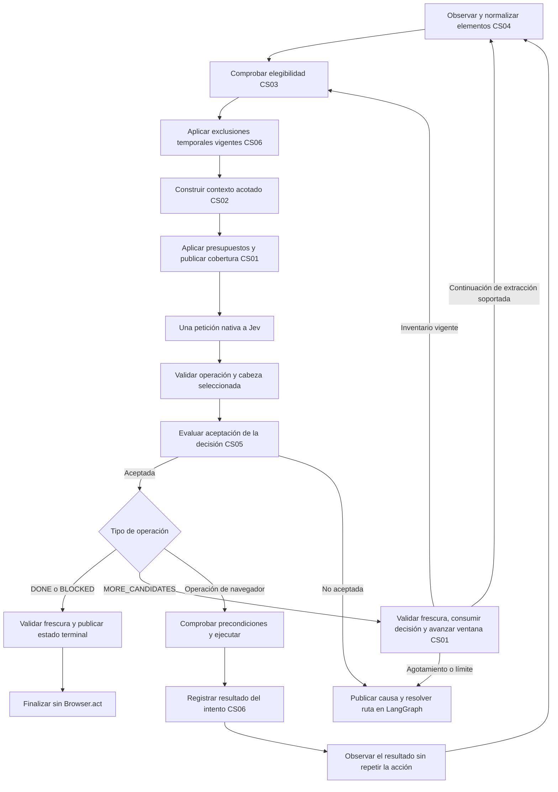

# Especificaciones del selector de candidatos

Fecha de referencia del diagnóstico: 16 de octubre de 2026. Estado: **CS01 implementada para el lector actual; CS02 parcialmente implementada; CS04 fase A implementada. CS03, CS05, CS06 y el resto de CS04 siguen como propuestas**.

Actualización: 19 de octubre de 2026. Además del presupuesto y las reconsultas de CS01, el agente incluye contexto acotado por control y desplazamiento vertical por región. La revisión de resultados y los rechazos previos incorporados a esta actualización no constituyen la implementación completa de CS05 o CS06.

Esta carpeta describe las seis limitaciones identificadas en la selección de candidatos de AgentRun. Cada documento explica el problema desde la experiencia del usuario y desde el código, compara soluciones y define una propuesta verificable. Su finalidad es permitir decidir e implementar cada mejora por separado, manteniendo la coherencia del conjunto.

La referencia del diagnóstico es el código disponible en el espacio de trabajo el 16 de octubre, incluidos sus cambios locales. Los ejemplos originales ilustran consecuencias deducidas de ese código; no representan tasas de fallo medidas en producción. Las secciones de implementación de CS01, CS02 y CS04 distinguen el comportamiento disponible de sus contratos todavía propuestos.

## 1. Documentos

| ID | Limitación y documento | Consecuencia principal | Dirección de la solución |
| --- | --- | --- | --- |
| CS01 | [Presupuesto y recorte de candidatos](01_presupuesto_y_recorte.md) | Un control puede quedar fuera porque otros consumen el límite antes, especialmente los campos y los selectores con muchas opciones. | Presupuestos por ventana, reparto estructural, omisiones observables y reconsulta de candidatos pendientes hasta encontrar uno adecuado o alcanzar un límite explícito. |
| CS02 | [Contexto semántico de cada candidato](02_contexto_semantico.md) | Controles con etiquetas iguales resultan difíciles de asociar a su tarjeta, fila, formulario o diálogo. | Contexto local acotado, relaciones explícitas y destinos de enlaces minimizados. |
| CS03 | [Ejecutabilidad y oclusiones](03_ejecutabilidad_y_oclusiones.md) | Se ofrece al modelo un objetivo que el ejecutor después rechaza porque está cubierto o no es alcanzable. | Comprobar elegibilidad antes de decidir y volver a validar inmediatamente antes de actuar. |
| CS04 | [Cobertura y descubrimiento](04_cobertura_y_descubrimiento.md) | El objetivo puede existir sin entrar en la observación por su posición, contenedor o estructura DOM. | Ampliación gradual de extracción y navegación por contenedores, con identidad y soporte de ejecución explícitos. |
| CS05 | [Incertidumbre en la selección](05_incertidumbre_en_la_seleccion.md) | Una respuesta válida y ganadora por poco puede ejecutarse aunque resulte ambigua. | Separar validez del protocolo y aceptación de la decisión, con una política evaluada y controlada por el grafo. |
| CS06 | [Memoria de intentos rechazados](06_memoria_de_intentos_rechazados.md) | El agente puede volver a elegir un objetivo rechazado sin disponer de su causa en el contexto de decisión. | Registro de intentos y resultados, memoria acotada y exclusiones temporales condicionadas al contexto. |

Cada especificación distingue el punto de partida, diseño, alternativas, módulos afectados, riesgos y pruebas sin APIs de pago. CS02 utiliza actualmente un objeto `context` acotado por elemento y conserva destinos observados para revisar navegaciones; el mapa compartido, los descriptores `href_hint` y la redacción propuestos siguen pendientes. CS04 ofrece cabezas de objetivo para el scroll vertical de documento y paneles; las continuaciones de extracción, nuevas familias de controles, shadow DOM y frames siguen pendientes.

## 2. Punto de partida del diagnóstico

Antes de CS01, [snapshot.js](../../AgentBrowser/snapshot.js) extraía acciones, recortaba la lista a 250 y añadía desplazamiento y espera. La implementación actual conserva un inventario acotado y prepara ventanas bajo cuotas combinadas. [action_space y choose](../../AgentBrowser/model.py) agrupan las acciones admitidas y construyen la petición nativa de Jev. Una petición incluye la elección de operación y las cabezas de objetivo de las operaciones disponibles. Solo se consume la cabeza correspondiente a la operación elegida.

[Browser](../../AgentBrowser/browser.py) comprueba frescura y precondiciones antes de ejecutar. [Agent](../../AgentBrowser/agent.py) consume la decisión, llama al auxiliar de texto cuando corresponde y registra una ejecución completada antes de observar su resultado. [LangGraph](../../AgentBrowser/workflow.py) controla el avance, la recuperación de observaciones obsoletas y la terminación.

Estas responsabilidades son la base de las mejoras. La selección no es únicamente el ranking de Jev: también depende de qué observa el lector, qué admite el ejecutor, qué entra en el presupuesto y qué información llega a la petición.

## 3. Integración propuesta

El orden conceptual de integración sería el siguiente. No exige convertir cada etapa en un nodo de LangGraph ni añadir otro modelo.

El registro del intento comienza **antes de cualquier posible efecto de navegador**. La etapa posterior a la ejecución actualiza su resultado antes de observarlo. `DONE` y `BLOCKED` no generan intentos de navegador; la frescura fallida, también en esas decisiones, vuelve a la ruta de recuperación del grafo. `DONE` sigue pendiente de verificación independiente del objetivo. El diagrama muestra la relación funcional entre etapas; CS06 define la secuencia de registro detallada y diferencia rechazo previo, ejecución completada y efecto incierto.

`MORE_CANDIDATES` es una operación de control implementada, sin target, `Browser.act` ni auxiliar textual. Permite obtener otra ventana cuando la actual no ofrece una acción adecuada y quedan candidatos consultables. Cada ventana evaluada implica una nueva decisión Jev dentro de los límites globales. El diagrama representa la continuación automática; `tick` y `act` preparan y publican la siguiente ventana sin encadenar otra decisión, y `predict` no avanza. CS01 conserva el cursor y distingue el progreso acumulado de la cobertura de cada ventana; CS04 gestiona las continuaciones de extracción soportadas. Una lista agotada o limitada no demuestra ausencia del elemento ni éxito de la tarea.

El contexto de CS02 forma parte del presupuesto total de CS01. Si el paquete no cabe, la reducción debe dejar constancia de lo omitido. CS03 y CS06 pueden retirar candidatos por motivos distintos; sus contadores y causas deben mantenerse separados. CS04 no convierte automáticamente en ejecutable todo lo que logra descubrir.

Las pausas propuestas distinguirán `review_kind=selection`, cuando la decisión aún no se ha ejecutado, y `review_kind=execution`, cuando ya se consumió. Solo la primera puede continuar con `act` sobre esa decisión. La segunda permite reconciliar mediante lecturas y resolver el estado; cualquier continuación posterior requiere una decisión nueva y nunca reproduce el intento consumido.

## 4. Contratos compartidos

La implementación de cada especificación deberá conservar estas reglas:

1. **Un objetivo en lenguaje natural.** No se incorporan planes por sitio, reglas de negocio basadas en dominios ni valores de formularios codificados a mano.
2. **Identidad verificable.** El índice presentado a Jev es temporal. La identidad local propuesta distingue sesión, documento, marco cuando exista y nodo observado. Una etiqueta igual o un índice reutilizado no demuestran que sea el mismo objetivo.
3. **Compatibilidad entre operación y objetivo.** Solo se ofrecen operaciones que el ejecutor soporte para ese elemento. La selección sigue resolviéndose contra la observación que originó la decisión; el modelo no emite selectores ni código.
4. **Una petición por decisión.** Se preserva el protocolo nativo con operación y cabezas específicas en una solicitud. Cada nueva ventana consultada por CS01 requiere una decisión nueva y contabilizada; no se añade un selector o planificador LLM intermedio. Las operaciones de control sin target no consumen cabezas de otras operaciones.
5. **Control del flujo en LangGraph.** Las políticas locales calculan datos o resultados; el grafo determina continuar, recuperar, suspender o terminar. Cualquier estado nuevo requiere adaptar también los consumidores del agente.
6. **Sin repetición de mutaciones.** Reobservar no autoriza a repetir una acción que pudo producir un efecto. La incertidumbre posterior al envío de entrada se distingue de un rechazo demostrado anterior al primer efecto.
7. **Texto con el auxiliar.** `TYPE_TEXT` sigue invocando el auxiliar. Un valor en caché solo se reutiliza si coincide toda la entrada efectiva del auxiliar, incluidos los campos nuevos que llegaran a incorporarse a ella.
8. **Evidencia independiente.** `DONE`, una distribución válida y una puntuación alta no prueban el éxito. Las pruebas de tareas verifican el resultado observable por separado.
9. **Datos y observabilidad acotados.** No se incluyen credenciales, guardas completas, volcados DOM ilimitados ni capturas como entrada al modelo. Las métricas deben distinguir observación, filtrado, presupuesto, decisión y ejecución.

## 5. Orden de trabajo y dependencias

La prioridad propuesta responde a dependencias y al efecto esperado a partir de la revisión del código; todavía no es una clasificación basada en medidas comparativas.

| Etapa | Trabajo | Condición para avanzar |
| --- | --- | --- |
| Base común | Fixtures locales, identidades y contadores por etapa | Poder explicar por qué un objetivo se incluyó, se omitió o se rechazó sin llamar a modelos reales. |
| Primera mejora | CS03, CS02 y CS01 | El paquete de decisión contiene objetivos compatibles, contexto suficiente y límites comprobables. CS01 presupuestará también el nuevo contexto. |
| Recuperación | CS06 | Se distinguen rechazos previos y efectos inciertos; la recuperación no reproduce entradas. |
| Aceptación | CS05 | Hay datos de evaluación y rutas finitas para decisiones no aceptadas. Los umbrales se justifican con evidencia. |
| Ampliación gradual | CS04 | Cada nueva familia de candidatos tiene observación, identidad, ejecución y pruebas completas antes de habilitarse. |

CS04 puede investigarse en paralelo, pero una ampliación de cobertura exige volver a medir el presupuesto de CS01 y la ambigüedad de CS05. La primera versión de CS03 puede conservar el centro del elemento como único punto de interacción; ofrecer varios puntos necesita que el ejecutor utilice un punto comprobado y vuelva a validarlo.

## 6. Validación y cierre

Los criterios particulares están en cada documento. La evaluación conjunta usará páginas locales reproducibles, respuestas del proveedor simuladas y comprobaciones del estado final. Debe cubrir etiquetas repetidas, selectores extensos, elementos cubiertos, desplazamientos, reemplazo de nodos, respuestas casi empatadas y fallos antes y después de enviar entrada. La reconsulta cubrirá objetivos en ventanas posteriores, decisiones de ventanas caducadas, agotamiento, límites acumulados y cero entradas de navegador al cambiar de ventana.

Se conservarán como regresiones los contratos de [test_agent.py](../../tests/test_agent.py), [test_workflow.py](../../tests/test_workflow.py) y [test_runnables.py](../../tests/test_runnables.py). Las nuevas pruebas deben demostrar comportamiento observable y ausencia de efectos duplicados; no bastará con reproducir el pseudocódigo de la solución.

Para cada implementación se ejecutarán los checks del repositorio: `uv run ruff check .`, `uv run pytest`, `node --check jev_ultrafast/static/app.js` y `uv build`; cuando cambie el lector, también `node --check jev_ultrafast/snapshot.js`. Los resultados documentarán versión evaluada, escenarios, contadores y limitaciones que sigan abiertas. Ninguna prueba automatizada de esta propuesta necesita una API de pago.

Una especificación solo pasará a implementada cuando su código, pruebas, documentación de uso y evidencia estén alineados. Resolver una limitación no implica que las otras cinco estén resueltas ni garantiza cobertura de cualquier sitio web.
