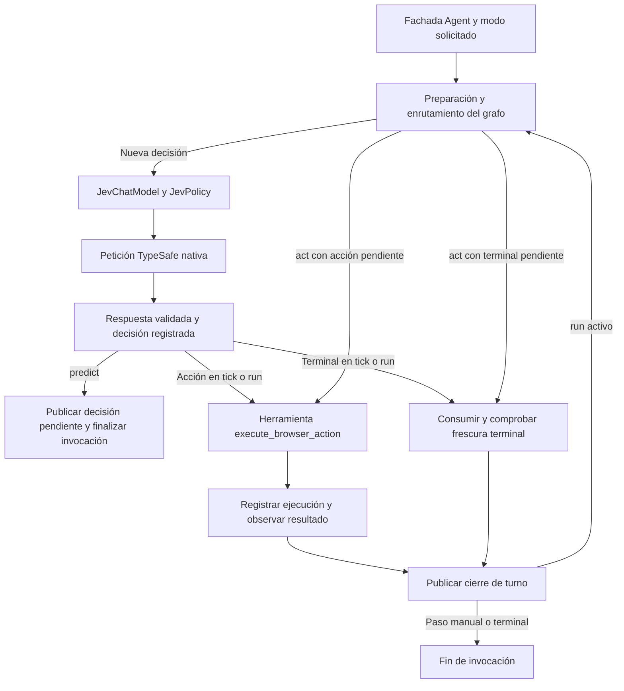

# Migración de AgentRun a un agente de LangChain

**Identificador:** EST01

**Versión:** 0.1

**Fecha:** 2026-10-16

**Estado:** Propuesta sin implementar

**Destino:** Equipo de desarrollo de AgentRun

**Índice:** [Especificaciones de estructura](README.md)

La migración propuesta sustituye el grafo de orquestación propio por un agente construido con `langchain.agents.create_agent`. Conserva Jev como modelo de decisión, su protocolo nativo de TypeSafe, el auxiliar de texto y la ejecución mediante Browser Harness. El resultado debe mantener el comportamiento observable de AgentRun y facilitar su integración con las interfaces de modelos, herramientas y middleware de LangChain.

El agente actual ya usa LangChain Core y LangGraph. El cambio consiste en adoptar la fábrica de agentes de LangChain y adaptar sus límites de turno al navegador. LangGraph seguirá controlando las rutas. La primera entrega no añadirá otro planificador, nuevas capacidades de navegación, persistencia durable ni reintentos de acciones.

## 1 Contenido

1. [Objetivo y alcance](#2-objetivo-y-alcance)
2. [Arquitectura actual](#3-arquitectura-actual)
3. [Requisitos](#4-requisitos-funcionales-y-garantías)
4. [Alternativas](#5-alternativas-y-decisión-de-diseño)
5. [Arquitectura propuesta](#6-arquitectura-propuesta)
6. [Estado e identidades](#7-estado-identidades-y-propiedad-de-los-datos)
7. [Adaptador Jev](#8-adaptador-de-jev)
8. [Herramienta de ejecución](#9-herramienta-de-ejecución)
9. [Modos y terminales](#10-contrato-de-los-modos-públicos)
10. [Middleware y mensajes](#11-enrutamiento-mediante-middleware)
11. [Errores y presupuestos](#13-errores-recuperación-y-cancelación)
12. [Compatibilidad](#15-compatibilidad-de-biblioteca-cli-e-inspector)
13. [Fases y reversión](#19-plan-de-implementación)
14. [Pruebas y aceptación](#21-plan-de-pruebas)
15. [Dependencias y decisiones pendientes](#24-relación-con-las-especificaciones-de-candidatos)

## 2 Objetivo y alcance

La entrega se considerará útil si permite construir el agente con `create_agent`, mantener una única autoridad de ejecución y utilizar callbacks, herramientas y middleware sin alterar el contrato de Jev. La migración deberá poder activarse por instancia y compararse con la implementación actual mediante pruebas reproducibles.

Incluye el adaptador del modelo, una herramienta controlada de navegador, estado tipado, middleware de turno, compatibilidad de la fachada `Agent`, configuración del backend, pruebas y documentación de uso. Incluye también un registro local mínimo de decisiones consumidas y ejecuciones para conservar evidencia aunque una excepción interrumpa la actualización del grafo. Dos refuerzos se declaran como cambios deliberados: bloquear nuevas mutaciones de una instancia tras un efecto incierto y fijar la configuración de generación durante la sesión. Su integración y evaluación se separan de la paridad estricta de orquestación.

Quedan fuera la sustitución de Jev, agentes jerárquicos, planificación por sitio, herramientas arbitrarias, generación de selectores o código, mejoras del selector de candidatos, navegación simultánea sobre una misma sesión, ejecución distribuida, checkpoints, restauración entre procesos y memoria entre tareas. Las capturas siguen siendo opcionales y destinadas a personas.

La migración no promete mejorar la precisión, reducir llamadas al proveedor ni resolver las seis limitaciones de candidatos. Esos resultados requerirían cambios y evaluaciones independientes.

## 3 Arquitectura actual

La referencia es el código del espacio de trabajo en la fecha indicada, incluidos sus cambios locales. Antes de implementar se conservará una referencia reproducible de esta base, sin atribuirla a un commit que no contenga esos cambios.

| Componente actual | Responsabilidad y contrato |
| --- | --- |
| [agent.py](../../AgentBrowser/agent.py) | Posee sesión, estado y caché textual; expone `command`, `run`, `snapshot` y cierre; consume decisiones y registra acciones |
| [workflow.py](../../AgentBrowser/workflow.py) | Construye un `StateGraph` con observar, elegir, ejecutar, recuperar y publicar |
| [runnables.py](../../AgentBrowser/runnables.py) | Adapta la política Jev y el auxiliar a `RunnableLambda` |
| [model.py](../../AgentBrowser/model.py) | Construye la solicitud TypeSafe, valida respuestas y solicita valores textuales |
| [browser.py](../../AgentBrowser/browser.py) | Observa, comprueba frescura y ejecuta operaciones sobre nodos observados |
| [snapshot.js](../../AgentBrowser/snapshot.js) | Extrae texto, acciones, identidades y guardas del documento |
| [cli.py](../../agentrun/cli.py) y [demo.py](../../AgentBrowser/demo.py) | Exponen ejecución por terminal e inspector |

La dependencia declarada es `langchain-core`, junto con `langgraph`; [pyproject.toml](../../pyproject.toml) todavía no incorpora el paquete `langchain` que aporta la fábrica propuesta.

Jev elige operación y objetivos por operación en una solicitud lógica. El código valida la operación y solamente la cabeza de objetivo seleccionada. `TYPE_TEXT` llama al auxiliar después de consumir la decisión y antes de introducir texto. El ejecutor vuelve a comprobar frescura tras esa llamada.

El historial se amplía cuando `Browser.act` retorna y antes de observar su resultado. La recuperación conserva ese historial. Las decisiones rechazadas antes de actuar no son acciones ejecutadas. La implementación utiliza límites de 60 acciones y 120 decisiones registradas, además de una detección de falta de progreso sobre las últimas tres entradas: bloquea solo cuando las tres tienen `page_changed is False` y ninguna es una espera. No busca tres acciones anteriores saltándose las esperas intermedias.

Los reintentos HTTP de `post_json` son distintos de las decisiones lógicas: actualmente hay hasta tres intentos ante determinados estados del proveedor. El contador de decisiones aceptadas no constituye un contador exacto de solicitudes HTTP.

## 4 Requisitos funcionales y garantías

| ID | Requisito obligatorio | Evidencia de aceptación |
| --- | --- | --- |
| RF01 | Recibir un único objetivo natural; conservar la unión actual de entradas múltiples por compatibilidad | Mismo objetivo efectivo en ambos backends |
| RF02 | Utilizar `create_agent` y conservar el enrutamiento dentro del grafo generado por LangGraph | Prueba con grafo real, sin bucle agente externo |
| RF03 | Mantener la petición nativa de Jev y consumir solo la cabeza elegida | Comparación de cuerpos y respuestas simuladas |
| RF04 | Producir como máximo una llamada de herramienta por decisión no terminal | Rechazo de cero llamadas inesperadas o múltiples llamadas antes de input |
| RF05 | Resolver toda acción contra la observación original y las operaciones admitidas | Cero entrada con referencias falsas o incompatibles |
| RF06 | Conservar el auxiliar para `TYPE_TEXT` y su caché por entrada completa idéntica | Casos de reutilización e invalidación |
| RF07 | Mantener `predict`, `act`, `tick` y `run` | Pruebas de fronteras de turno y conteo de inferencias |
| RF08 | Consumir cada decisión como máximo una vez | Repetición de `act` sin segunda entrada |
| RF09 | Registrar ejecución antes de observar el resultado | Fallo de observación sin pérdida del historial |
| RF10 | No repetir mutaciones ni continuar automáticamente tras efecto incierto | Fallos parciales con cero reenvíos |
| RF11 | Conservar límites, terminales y verificación independiente | Pruebas de presupuestos y estado final |
| RF12 | Mantener credenciales y recursos vivos fuera de mensajes y argumentos de herramientas | Inspección de solicitudes y serialización |
| RF13 | Conservar API pública, CLI e inspector | Pruebas de compatibilidad y empaquetado |
| RF14 | Permitir activación y reversión por nuevas instancias | Backend inmutable durante cada ejecución |

El significado de «una ejecución» es una invocación del protocolo del ejecutor, que puede contener varios eventos CDP. No se promete una transacción atómica del sitio ni una garantía de exactamente un efecto remoto. La garantía exigida es no reenviar automáticamente una mutación ya iniciada o consumida.

## 5 Alternativas y decisión de diseño

| Alternativa | Ventajas | Costes y límites |
| --- | --- | --- |
| Conservar el grafo actual | Ajuste directo al navegador y menor superficie de cambio | Mantiene una orquestación propia |
| Adaptar Jev a `create_agent` | Interfaces estándar de modelo, herramientas y middleware | Exige resolver modos manuales, mensajes y fronteras de efectos |
| Sustituir Jev por un modelo conversacional con herramientas | Encaja con el uso habitual de la fábrica | Cambia el modelo y el protocolo de decisión; queda fuera del alcance |
| Envolver `Agent.run` como herramienta de otro agente | Integra el agente como capacidad de un sistema superior | Añade otro controlador y potencialmente otras inferencias; no sustituye la orquestación actual |

Se propone la segunda alternativa. El agente resultante seguirá especializado en decisiones sobre elementos observados. Su adaptador no será un modelo de conversación general ni aceptará cualquier catálogo de herramientas.

La fábrica construye el ciclo de modelo y herramientas sobre LangGraph. Esta capacidad oficial permite plantear la migración; la equivalencia con los modos de AgentRun debe demostrarse en la fase inicial. [Agentes de LangChain](https://docs.langchain.com/oss/python/langchain/agents), [arquitectura de LangChain y LangGraph](https://www.langchain.com/oss-overview).

## 6 Arquitectura propuesta

La fachada pública `Agent` posee una sesión y delega en un backend elegido al construirla. Solo un backend puede controlar esa sesión. El backend nuevo construye `create_agent` con `JevChatModel`, una herramienta de ejecución y un middleware de ciclo. No llama al `run` o `tick` del backend anterior desde una herramienta.



Los rechazos previos a input y las observaciones obsoletas siguen rutas de recuperación de lectura dentro del grafo. Los errores definitivos terminan la invocación. No se añade un modelo para producir un resumen después de cada herramienta.

Se propone esta distribución interna, ajustable sin cambiar los contratos:

| Archivo propuesto | Responsabilidad |
| --- | --- |
| `jev_ultrafast/session.py` | Recursos vivos, registros de decisiones y ejecuciones, exclusión por sesión y caché textual |
| `jev_ultrafast/chat_model.py` | Adaptador `JevChatModel` y conversión de decisiones a mensajes |
| `jev_ultrafast/tools.py` | Herramienta única y recibos de ejecución |
| `jev_ultrafast/middleware.py` | Preparación, rutas por modo, validación de mensajes y cierre de turno |
| `jev_ultrafast/langchain_workflow.py` | Construcción y adaptación del grafo `create_agent` |

`workflow.py` permanece como backend `custom` durante la transición. `agent.py` conserva la interfaz pública y delega. El lector y el cuerpo nativo se reutilizan; cualquier instrumentación de la frontera de input en `browser.py` debe conservar su comportamiento y probarse por separado.

## 7 Estado identidades y propiedad de los datos

### Estado del grafo

El estado amplía `AgentState` con datos serializables. La tabla define contratos propuestos, no nombres disponibles actualmente.

| Campo | Contenido y regla |
| --- | --- |
| `run_id` | Identifica la tarea y su sesión propietaria |
| `mode` | `run`, `tick`, `predict` o `act`, fijado por la fachada |
| `command` | Datos validados del comando, incluido fingerprint cuando corresponde; no admite estado del cliente |
| `invocation_id` e `is_entry` | Identifican la invocación actual y su entrada, sin reiniciar presupuestos |
| `goal` | Objetivo efectivo, estable durante la tarea |
| `observation_id` y `page` | Identidad de lectura y observación actual |
| `pending_decision_id` | Referencia a una decisión aún no consumida, o `null` |
| `status` | Conserva `ready`, `predicted`, `done` y `blocked` |
| `phase` | Fase interna de preparación, decisión, ejecución o cierre; no sustituye el estado público |
| `history`, `decisions`, `text_calls` | Proyecciones compatibles de los registros de sesión |
| `messages` | Mensajes de protocolo acotados; no son la autoridad de ejecución |
| `turn_sequence` y `published_sequence` | Identifican cierres de turno y evitan publicaciones duplicadas |
| `recovery_reason` e `invocation_error_ref` | Control y error de la invocación actual; nunca instrucciones de la página |
| `session_effect_uncertain` | Proyección de una barrera persistente durante la vida de la instancia |
| `session_revision` | Revisión monotónica que impide sobrescribir evidencia con una proyección antigua |
| `elapsed_ms` | Duración de la ejecución conforme al reloj de la sesión |

Los campos no reducidos se reemplazan con una proyección completa coherente, sin sumar dos veces historiales o contadores. `messages` utiliza el reductor de mensajes de la versión elegida, con IDs estables para evitar duplicación. El estado público seguirá excluyendo el navegador y no expondrá automáticamente todos los campos internos.

### Recursos vivos y autoridad de ejecución

`SessionContext` contendrá `Browser`, clientes y configuración del proveedor, control de acceso exclusivo, caché textual y registros locales. La fachada pasa este contexto a la ejecución; el modelo no lo puede construir mediante argumentos. El objeto `Browser`, los locks, sockets y credenciales no forman parte del estado serializable.

La sesión es la autoridad de decisiones consumidas y efectos iniciados. El grafo controla las transiciones y mantiene una proyección para observación. Una excepción no puede restaurar una decisión consumida porque una actualización del grafo no llegó a aplicarse. Al terminar o fallar una invocación, la fachada reconstruye el estado público desde los registros autorizados.

Esto requiere una única política de propiedad de los campos; no se permiten dos diccionarios mutables que decidan independientemente si una acción sigue pendiente. Si se mantiene `Agent.state` como vista compatible con pruebas o consumidores existentes, será una adaptación explícita de la sesión. Esa vista no se introduce íntegramente en `AgentState`.

La primera versión conserva memoria únicamente durante la vida de la instancia. No utiliza checkpointer, almacenamiento remoto ni restauración desde disco. Una caída del proceso termina la capacidad de continuar esa instancia; no se reconstruye automáticamente la tarea sobre otra pestaña.

### Identidades

`observation_id` identifica una lectura aceptada, aunque su fingerprint coincida con otra lectura. `decision_id` identifica una respuesta validada vinculada a esa observación. `tool_call_id` identifica su representación en el protocolo de herramientas. `attempt_id` identifica un intento local de ejecutar una decisión no terminal.

Todos se generan por código y pertenecen a un `run_id`. Una decisión conserva operación, objetivo, acción original, fingerprint y datos necesarios para las comprobaciones de frescura. Un índice como `e3` o `2:4` no puede trasladarse a otra observación.

Estas identidades no incorporan soporte de frames nuevo. La referencia observada sigue resolviéndose mediante la sesión y el registro DOM actuales. La identidad ampliada para futuros frames de CS04 permanece fuera de esta migración.

## 8 Adaptador de Jev

### Interfaz del modelo

`JevChatModel` implementará el contrato de `BaseChatModel` necesario para invocación, identificación y enlace de herramientas. La implementación concretará `_generate`, `_llm_type` y `bind_tools` contra las versiones bloqueadas. No se fingirá compatibilidad con modelos conversacionales ni protocolos que Jev no utiliza. [Implementación oficial de BaseChatModel](https://github.com/langchain-ai/langchain/blob/master/libs/core/langchain_core/language_models/chat_models.py).

`bind_tools` aceptará únicamente la herramienta prevista y su esquema exacto. Rechazará herramientas adicionales, formatos estructurados de respuesta no soportados y opciones que alteren la semántica. El catálogo de herramientas no se enviará como sustituto de las preguntas nativas de TypeSafe.

El middleware prepara una entrada inmutable de política con la misma página, objetivo e historial que usa actualmente `JevPolicy`. La conecta al adaptador mediante un parámetro de invocación privado o una referencia de solicitud emitida por la sesión. La fase 0 debe verificar ese transporte usando la API pública de la versión elegida. No se reconstruye la observación interpretando lenguaje natural del historial de chat ni se guarda el payload en una variable global compartida.

Se desactiva la caché general del modelo para decisiones. Dos llamadas con el mismo objetivo textual pueden pertenecer a observaciones distintas. La única caché preservada por este diseño es la del auxiliar bajo su regla específica.

### Camino de decisión

La secuencia será:

1. Recibir la entrada preparada por el controlador y comprobar su pertenencia a la sesión y observación.
2. Invocar `JevPolicy` una vez, conservando callbacks y configuración.
3. Construir y enviar exactamente el cuerpo nativo actual mediante `model.choose`.
4. Validar operación y únicamente la cabeza seleccionada con las reglas existentes.
5. Registrar la decisión aceptada y sus metadatos sin consumirla.
6. Emitir un `AIMessage` de protocolo producido por código.

Una acción produce una única llamada con argumentos que referencian la decisión. El siguiente ejemplo representa el resultado de la traducción local; Jev no genera este JSON libremente:

```json
{
  "content": "",
  "tool_calls": [
    {
      "name": "execute_browser_action",
      "args": {
        "decision_id": "d17",
        "observation_id": "o12"
      },
      "id": "tc17",
      "type": "tool_call"
    }
  ]
}
```

Para `DONE` y `BLOCKED`, el mensaje no contiene llamadas de herramienta y lleva una referencia interna a la decisión terminal. El middleware consulta el registro autorizado; no busca las palabras DONE o BLOCKED en el texto para determinar el estado. Una salida sin herramientas y sin referencia terminal válida es un error de contrato, no un final satisfactorio.

Se conservan `operation_probabilities`, `target_probabilities`, `confidence`, `target_confidence`, `raw_answers`, `request`, modelo, uso y latencia en los registros existentes. Un campo `usage_metadata` de LangChain solo se poblará si puede mapearse sin inventar unidades ni sumar dos veces la misma inferencia. El uso nativo original permanece disponible.

### Terminación y fallos del adaptador

Una respuesta inválida o un error de proveedor termina con el error actual, sin tool call y sin corrección mediante otra llamada LLM. No se añade una inferencia para reparar JSON o explicar la decisión.

Un `StalePage` que el contrato existente permita recuperar se convierte en un resultado de control interno autenticado por la sesión, no en una decisión ni una respuesta terminal. Su ruta se define en la sección 13. Los mensajes de control no incrementan el contador de decisiones aceptadas.

No se exige streaming de tokens de Jev. El streaming público requerido es el de turnos completos del agente. La API asíncrona, si se expone, debe respetar la misma exclusión por sesión y nunca iniciar dos ejecuciones simultáneas.

## 9 Herramienta de ejecución

### Contrato

```text
execute_browser_action(
    decision_id: string,
    observation_id: string,
    runtime: contexto inyectado por el framework
) -> actualización de estado y recibo de herramienta
```

El esquema visible contiene únicamente los dos IDs. No acepta operación alternativa, nodo arbitrario, selector, código, coordenadas, URL de destino ni texto de formulario. El runtime aporta acceso a la sesión y al estado sin convertirse en argumento generado. LangChain documenta la inyección mediante `ToolRuntime` y las actualizaciones mediante `Command`; el recibo debe incluir un `ToolMessage` asociado al `tool_call_id`. [Herramientas y runtime](https://docs.langchain.com/oss/python/langchain/tools).

Las referencias se comprueban contra sesión, observación, decisión pendiente y tool call registrado. La herramienta rechaza campos extra, IDs inexistentes, cruces de tareas, decisiones terminales y decisiones ya consumidas. Un duplicado falla explícitamente; no devuelve una confirmación nueva ni reenvía entrada.

### Secuencia y registro local

La exclusión por sesión comprende todo el comando, incluida observación, inferencia y ejecución. Dos comandos concurrentes no pueden predecir o ejecutar sobre una sesión intercalada. La segunda petición se rechaza como ejecución ocupada según el contrato público que se defina, sin entrar en el navegador. Los hooks verifican la propiedad de la invocación incluso si se accede al grafo directamente; exponer `Agent.graph` no permite eludir el contexto ni el control de sesión.

Dentro de la herramienta:

1. Comprobar el comando y la referencia pendiente. Un fingerprint de cliente incorrecto se rechaza antes de consumir, como ocurre actualmente.
2. Consumir la decisión de forma irrevocable en la sesión y crear un registro `prepared` antes del helper o de cualquier posible input.
3. Aplicar el límite de acciones y las comprobaciones correspondientes. Conservar el orden observable de errores y consumo de la implementación actual.
4. Para escritura, comprobar frescura, obtener o reutilizar texto válido y volver a comprobar antes de entrada.
5. Llamar una sola vez al ejecutor con una notificación interna de fase controlada por código. El ejecutor realiza primero sus comprobaciones de lectura.
6. Dentro del ejecutor, registrar `input_started` inmediatamente antes del primer comando que pueda producir efectos, y continuar una sola vez con la secuencia de entrada.
7. Cuando retorna, registrar ejecución y ampliar `history` antes de la observación posterior.
8. Observar el resultado, actualizar evidencia, falta de progreso y cierre de turno.
9. Devolver el recibo y la proyección de estado al grafo.

El registro mínimo distingue `prepared`, `input_started`, `execution_returned`, `observed`, `rejected_before_input`, `failed_before_input` y `effect_uncertain`. Son fases y resultados locales, no estados públicos nuevos de revisión. Sus timestamps son monotónicos de la sesión; no sirven para restaurar un proceso nuevo.

Para `SELECT`, la evaluación JavaScript actual valida y muta en una misma llamada. Se marca posible efecto antes de enviarla. Su interrupción o falta de confirmación se mantiene como incertidumbre; no se reclasifica como rechazo seguro por conveniencia del framework. Para `WAIT` no se marca input, aunque su ejecución siga contando en el historial según el contrato actual.

La instrumentación de esa frontera en `Browser` es obligatoria para esta clasificación. No se puede marcar todo `Browser.act` como input iniciado: comienza con frescura y precondiciones de solo lectura, cuyos rechazos deben seguir siendo recuperables. La notificación no es una herramienta adicional ni una función emitida por el modelo.

### Resultado y límite de garantía

Un recibo distingue si se inició entrada, si el ejecutor retornó y si se obtuvo observación posterior. Puede referenciar `history_step` y un código de causa. No copia por defecto el texto introducido, excepciones completas ni la página dentro del `ToolMessage`; la evidencia detallada permanece en la proyección compatible y los registros de sesión.

El registro es local y volátil. Su finalidad es sobrevivir a errores de nodos dentro de la instancia y rechazar duplicados. No es un journal durable ni habilita replay de checkpoints. Una confirmación del ejecutor tampoco demuestra que el sitio completara una operación de negocio.

## 10 Contrato de los modos públicos

| Modo | Entrada necesaria | Decisiones nuevas | Ejecuciones de navegador | Resultado |
| --- | --- | --- | --- | --- |
| `predict` | Objetivo y sesión activa | Como máximo una por invocación | Cero, incluido helper textual | `predicted` con decisión pendiente, o error |
| `act` | Decisión pendiente y fingerprint correcto | Cero | Como máximo una | Estado tras ejecutar o finalizar el terminal pendiente |
| `tick` | Sesión activa | Como máximo una | Como máximo una | Un turno publicado; la recuperación puede producir un turno sin acción |
| `run` | Sesión activa | Una por turno que llegue a decidir | Como máximo una por decisión | Flujo de turnos hasta terminal o error |

«Como máximo una» describe la inferencia lógica; los intentos HTTP de transporte se contabilizan aparte. `TYPE_TEXT` puede añadir su llamada auxiliar únicamente durante ejecución.

### Predicción

`predict` prepara la página como el código actual, obtiene una decisión y termina antes de ejecutar. Incluso una elección `DONE` o `BLOCKED` permanece como predicción: no cambia aún a estado terminal ni consume la decisión. Esto preserva el inspector, que separa elegir y actuar.

Una segunda predicción descarta la pendiente anterior antes de obtener otra. El descarte se registra y su tool call pendiente se resuelve o retira de los mensajes de protocolo sin fingir que hubo ejecución. No se permite que dos decisiones queden actuables a la vez.

### Ejecución manual

`act` no pasa por la preparación que borra decisiones ni llama al proveedor. El grafo recibe la proyección mantenida por la fachada y verifica primero la decisión y fingerprint. Una acción pendiente salta al nodo de herramientas. Una decisión terminal utiliza la función compartida de finalización sin herramienta.

Si el cliente aporta un fingerprint incorrecto, la decisión permanece disponible. Si el fingerprint coincide pero la página real ya cambió, se consume la decisión antes de propagar el rechazo correspondiente, conforme al comportamiento actual. Repetir el comando no puede recuperar ese permiso.

### Turno y ejecución continua

`tick` se detiene después de publicar el resultado de una acción, un terminal o una recuperación de lectura. No ejecuta una inferencia adicional de cierre.

`run` continúa dentro del grafo. La fachada adapta el stream a snapshots de turnos completos mediante `turn_sequence`; no implementa un `while` que invoque repetidamente `tick`. La instancia conserva el mismo presupuesto durante toda la tarea y entre comandos.

### Terminales

La función compartida de finalización realiza consumo de decisión, comprobación de frescura y transición a `done` o `blocked`. Se usa desde el procesamiento posterior al modelo en `tick/run` y desde la entrada de `act`. Solo observa; no llama a `Browser.act`, al helper ni a la herramienta.

En `run/tick`, una frescura terminal fallida recupera mediante lectura y publica el turno según las reglas existentes. En modo manual propaga el error con la decisión ya consumida. `run` sobre una tarea terminal no produce nuevos turnos; `predict/tick` mantienen el error de tarea detenida. Un `act` posterior al consumo falla primero por ausencia de decisión pendiente, como en la implementación actual. `DONE` continúa requiriendo un verificador independiente.

## 11 Enrutamiento mediante middleware

Se propone un único `BrowserCycleMiddleware` inicial para evitar dependencias implícitas entre varios hooks. Podrá dividirse después si se conserva el orden probado. Los hooks devuelven datos y destinos; LangGraph ejecuta las rutas.

La documentación oficial ofrece hooks antes y después del modelo, envolturas de llamadas y destinos `model`, `tools` y `end`. La fase 0 verificará la combinación exacta usada con la versión bloqueada; no se modificarán estructuras privadas del grafo generado. [Middleware personalizado](https://docs.langchain.com/oss/python/langchain/middleware/custom).

| Punto | Responsabilidad propuesta |
| --- | --- |
| `before_agent` | Validar modo y sesión; iniciar flags de invocación y comprobar la barrera de efecto incierto |
| `before_model` | Atender cierre de turno antes de inferir; resolver `act`; preparar observación y presupuesto de una decisión nueva |
| `wrap_model_call` | Transferir la entrada nativa preparada y propagar configuración; sin añadir reintentos |
| `after_model` | Validar el sobre emitido, guardar predicción, resolver terminales o permitir una herramienta |
| `wrap_tool_call` o cuerpo de herramienta | Controlar consumo y recibo; traducir únicamente resultados conocidos sin esconder efectos |
| `after_agent` | Proyectar estado y publicar final de invocación; nunca inferir ni mutar |

El siguiente pseudocódigo describe responsabilidades, no una implementación lista para copiar:

```text
before_model(state, session):
    if state.invocation_error_ref or session.effect_uncertain:
        return end
    if state.turn_is_closed:
        publish_once(state.turn_sequence)
        if state.mode != run or state.status is terminal:
            return end
        prepare_next_turn()
    if state.mode == act and state.is_entry:
        pending = validate_manual_command_without_consuming()
        if pending.is_terminal:
            finalize_terminal(pending)
            return end
        return tools
    prepare_fresh_observation_and_check_budget()
    return normal_continuation_without_jump

after_model(state, session):
    if trusted_control_result_requires_recovery:
        if state.mode in [predict, act]:
            propagate_original_stale_error()
        recover_read_and_close_turn()
        return model if state.mode == run else end
    decision = resolve_registered_model_result()
    if state.mode == predict:
        publish_predicted_without_consuming()
        return end
    if decision.is_terminal:
        finalize_terminal_or_recover()
        return model if recovered_and_run else end
    assert exactly_one_registered_tool_call()
    return tools
```

El avance normal de `before_model` devuelve actualizaciones sin `jump_to="model"`; no debe saltar a su propio inicio. El salto explícito hacia modelo desde `after_model` representa volver por la preparación prevista, sin llamar recursivamente al proveedor desde el hook. La fase 0 comprobará esa ruta en la fábrica elegida.

Al comenzar cada invocación, `before_agent` asigna un `invocation_id` nuevo, establece `is_entry=True` y reinicia exclusivamente los flags transitorios de cierre. Preserva la decisión pendiente, mensajes, secuencias acumuladas, revisión de sesión y presupuestos. Al despachar una acción manual marca `is_entry=False`. De este modo, un cierre heredado de `predict` no termina prematuramente `act` y una vuelta desde herramientas no ejecuta otra vez su rama de entrada.

La herramienta usará `return_direct=False`: terminar automáticamente tras cada herramienta impediría que `run` continuara dentro del mismo grafo. Para `tick/act`, el cierre se decide al alcanzar el siguiente punto de control, antes de otra inferencia. El backend no dependerá de nombres internos de nodos para publicar estado.

## 12 Mensajes y continuación sin checkpoints

Los mensajes satisfacen el protocolo de LangChain; Jev sigue recibiendo su representación nativa. No se añade al cuerpo TypeSafe un historial conversacional completo ni snapshots históricos por adoptar `AgentState`.

Después de `predict`, la fachada conserva el estado retornado y su mensaje pendiente dentro de la instancia. `act` inicia una nueva invocación del grafo con ese estado, sin añadir otra instrucción humana ni ejecutar el modelo. Esto es continuación de una instancia viva, no restauración de checkpoint.

Cada llamada ejecutada obtiene exactamente un `ToolMessage` con el mismo `tool_call_id`. Una llamada descartada antes de ejecutar se cierra con un recibo local `cancelled_before_dispatch`, que no entra en `history`. Un rechazo, un fallo de helper o una excepción posterior a input se cierra con un recibo que describe ese resultado, nunca con un éxito ficticio. Si la excepción impide devolver el estado del grafo, la fachada reconstruye el recibo desde el registro autorizado antes de aceptar otra invocación. Nunca se deja un par incompleto al volver a invocar el modelo, ni se cierra una predicción todavía pendiente como si ya estuviera ejecutada.

Se propone conservar el objetivo y, como máximo, los diez pares completos de acción/recibo más recientes, además de la decisión pendiente. El historial de negocio y los registros de decisiones mantienen sus límites propios. La reducción no utiliza otro LLM y no altera los diez registros de acciones que `model.choose` ya envía ni los seis que utiliza el helper.

El cliente HTTP del inspector no puede suministrar `messages`, estado completo, runtime o un `Command` de LangGraph. Solo envía los comandos públicos admitidos. El servidor construye las continuaciones desde su estado autorizado.

## 13 Errores recuperación y cancelación

### Matriz de errores

| Situación | Efecto conocido | Respuesta exigida |
| --- | --- | --- |
| ID, fingerprint o comando inválido antes del consumo | Ninguno | Error; sin proveedor adicional ni input |
| `StalePage` durante preparación o decisión | Ningún input de esa decisión | `run/tick` recuperan lectura y publican; modo manual propaga |
| Página obsoleta tras consumir y antes de input | Ninguno | Decisión inutilizable; recuperación según modo; nueva decisión para actuar |
| Fallo del helper | Ningún input | Propagar error; no inventar valor ni cambiar de modelo |
| Error del proveedor o respuesta inválida | Ningún input | Propagar; no reparación LLM ni fallback de backend |
| Ejecutor retorna y falla la observación con `StalePage` | Acción registrada | Recuperar únicamente lectura en `run/tick`; no repetir herramienta |
| Error no recuperable tras ejecutar | Puede existir efecto | Conservar registro y propagar; finalizar invocación |
| Error después de iniciar input sin confirmación | Efecto incierto | Barrera permanente para esa instancia: permitir diagnóstico y cierre, sin nuevos comandos de decisión o ejecución |
| `DONE` con página obsoleta | Sin input | Invalidar terminal y recuperar según modo |

La clasificación usa fase y evidencia, no cadenas de texto de excepciones. Que la comprobación inicial `fresh` devuelva falso no equivale por sí solo a un `StalePage`: la preparación ordinaria puede refrescar la observación también en `predict`, como hace hoy. Las rutas excepcionales de la tabla se aplican cuando la preparación o ejecución propaga ese error. Una observación fallida después de ejecutar no convierte esa ejecución en un rechazo previo.

### Entrega de errores al llamador

Se deben conservar las excepciones y respuestas públicas relevantes sin permitir que el manejo genérico de herramientas las convierta en nuevas instrucciones para el modelo. Una implementación admisible captura el resultado conocido en la envoltura de la herramienta, registra una referencia local al error y devuelve un recibo de protocolo con `invocation_error_ref`. El siguiente punto del grafo finaliza antes del modelo; la fachada propaga el error original después de sincronizar estado.

El error de invocación ya entregado puede limpiarse al iniciar un comando posterior, conservando su evidencia. No equivale a la barrera `session_effect_uncertain`: un fallo del helper o del proveedor antes de input no bloquea permanentemente la sesión. La barrera por efecto incierto permanece durante toda la instancia y no se elimina al limpiar flags, cambiar de modo o reobservar.

En la primera entrega no existe una API de desbloqueo de esa barrera. Se permite consultar la evidencia y cerrar la instancia; un reset crea otra tarea y no reproduce automáticamente la anterior. Este refuerzo es nuevo respecto al código actual, que propaga el error pero permite que el llamador solicite otro turno. Las pruebas compararán la paridad anterior al fallo y verificarán por separado la nueva restricción posterior.

Otra excepción inesperada puede propagarse directamente; el registro de sesión debe conservar el consumo y los efectos aunque el grafo descarte su actualización. En ambos caminos, el llamador obtiene el fallo y no hay una inferencia automática para «intentarlo de nuevo». Las trazas deben reflejar el resultado de error aunque exista un recibo de protocolo.

Un resultado interno de recuperación antes de una decisión aceptada se distinguirá de un `AIMessage` terminal. La sesión lo autentica mediante una referencia de control; ningún texto de página puede activar esa rama. La recuperación de lectura está acotada por los presupuestos del grafo y del lector existente.

### Cancelación y concurrencia

Una cancelación antes de input consume o descarta la decisión según la fase ya alcanzada, sin ejecutar después. Si el transporte no puede cancelarse de forma fiable tras comenzar input, se registra incertidumbre. No se asume que cerrar una conexión revierta eventos enviados.

La primera entrega no ofrece interrupción dura de una llamada HTTP síncrona ni control concurrente del navegador. `KeyboardInterrupt` sigue cerrando recursos y conserva la salida CLI correspondiente. La serialización por sesión evita ejecutar mientras otro comando sigue en progreso.

## 14 Texto auxiliar y presupuestos

### Auxiliar de texto

Se conservan `field_context`, `field_text`, la validación del JSON y `TextValue`. Una predicción de escritura no llama al helper; una ejecución válida sí. No se admiten valores suministrados por el mensaje principal ni reglas que extraigan literalmente datos del objetivo para saltarse el auxiliar.

La caché conserva el par de entrada completa y salida validada. Se reutiliza tras un rechazo seguro únicamente cuando coinciden todos los campos efectivos. La configuración del modelo y las instrucciones se fijan durante la ejecución; si se permite cambiarlas, forman parte de la identidad efectiva que invalida la caché. Las credenciales no se almacenan en una clave de caché ni en mensajes. Actualmente `model.py` consulta variables de entorno en cada llamada: fijarlas por sesión es un cambio deliberado que se implementará y probará para ambos backends al extraer `SessionContext`.

La decisión vieja permanece consumida incluso si su texto puede reutilizarse con una decisión nueva. Tras ejecución confirmada se limpia la caché pendiente; tras efecto incierto no se permite reutilizarla para repetir la operación. Los contadores distinguen generación aceptada, reutilización e intentos HTTP.

### Presupuestos

La primera implementación mantiene 60 entradas de acciones ejecutadas y 120 decisiones registradas, con la semántica actual de [questions.py](../../AgentBrowser/questions.py) y `agent.py`. Las esperas siguen contando como acciones, pero no activan por sí solas la regla de tres acciones sin cambio. Una herramienta técnica no equivale a una acción adicional de navegador.

Los límites se comprueban en los mismos puntos funcionales: antes de otra decisión cuando se agota su presupuesto, y antes de input cuando se agotan acciones. La comprobación de acciones no impide que una decisión terminal válida pueda finalizar la tarea, tal como sucede actualmente.

El límite de recursión necesita recalcularse para la topología nueva. No se copiará 730 suponiendo el mismo número de nodos por turno. La fase 0 determinará un límite derivado que permita toda la secuencia válida dentro de los presupuestos y detenga recuperaciones sin progreso. Se contará también el número de ciclos de recuperación que no consumen decisiones, para evitar que cambios continuos de página creen un recorrido ilimitado.

No se apilan retries del adaptador, middleware y transporte. La política HTTP actual permanece como única autoridad de reintento de proveedor. El ejecutor nunca usa un middleware de retry ni se cambia automáticamente de backend después de fallar.

## 15 Compatibilidad de biblioteca CLI e inspector

Se conservarán las importaciones públicas `from agentrun import Agent` y `from jev_ultrafast import Agent`, el context manager y los argumentos existentes del constructor. `snapshot()` mantendrá los campos usados por el inspector, incluidas distribuciones, requests y metadatos actuales, y continuará excluyendo `Browser`.

`Agent.graph` seguirá ofreciendo un grafo compilado real. Su topología y nombres internos podrán cambiar en el backend nuevo; esa diferencia se documentará. Los callbacks, tags y metadata de `RunnableConfig` deben llegar a los adaptadores. Un evento técnico del framework no se contabiliza como otra llamada al proveedor.

La fachada de `command` conserva el contrato `act` con `fingerprint`. Los IDs internos se resuelven en el servidor; si se añaden al JSON público serán campos aditivos, no una ruptura obligatoria del cliente actual. Los campos adicionales del inspector que ya se conservan no deben perderse al proyectar estado.

La CLI mantiene salida 0 para `done`, 2 para una finalización normal con `blocked` o los errores de configuración que actualmente usan ese código, 1 para una excepción de ejecución o fin sin terminal, y 130 para interrupción. Alcanzar el límite de acciones actualmente fija `blocked` y lanza `ValueError`, por lo que la CLI devuelve 1; el límite de decisiones también produce 1. Esos casos no se convertirán silenciosamente en salida 2. Se conserva el aviso de que `DONE` requiere verificación independiente. Esta migración no añade `needs_review` ni un código de salida nuevo.

Las diferencias deliberadas respecto a la base son la selección de backend, el registro local mínimo, el rechazo de continuación tras efecto incierto y la configuración de generación fijada por sesión. Las dos últimas se incorporarán de forma compartida antes de exigir paridad entre backends; la evidencia distinguirá esos refuerzos del cambio de orquestación.

El inspector sigue pudiendo alternar la secuencia `predict → act` y el uso de `tick`. El servidor mantiene exclusión de comandos y backend fijo. El frontend no recibe snapshots internos sin filtrar del framework ni capacidad para enviar herramientas directamente.

## 16 Dependencias y configuración

Se añadirá `langchain` con una versión compatible con `langchain-core`, `langgraph`, Python y el resto del proyecto. La implementación bloqueará versiones exactas en `uv.lock`; los rangos de `pyproject.toml` reflejarán únicamente combinaciones verificadas. No se instalará una integración de otro proveedor de chat para suplir Jev.

La fase 0 debe validar estas capacidades públicas sobre las versiones elegidas: `create_agent`, modelo personalizado, `bind_tools`, estado extendido, runtime de herramienta, actualización mediante `Command`, saltos de middleware y streaming. Si una combinación no las soporta, se elegirá otra versión compatible o se revisará el diseño antes de habilitar el backend. No se parcheará la librería de manera implícita.

Configuración propuesta:

| Opción nueva | Valores | Precedencia y momento |
| --- | --- | --- |
| Argumento `backend` de `Agent` | `custom`, `langchain` | Prevalece si se proporciona explícitamente |
| `AGENTRUN_BACKEND` | `custom`, `langchain` | Se lee tras la carga explícita de entorno |
| Predeterminado inicial | `custom` | Se usa si no hay configuración explícita |
| CLI `--backend` | Mismos valores | Se traduce al argumento del constructor |

Se valida la configuración antes de crear `Browser`. El valor queda fijado durante la instancia. La carga de `.env`, su referencia externa y sus precedencias se mantienen en [config.py](../../agentrun/config.py); importar el paquete no carga credenciales ni abre navegador.

El inspector captura el backend al iniciar. Un reset crea una instancia nueva con la configuración del servidor; el cuerpo de una solicitud no cambia arbitrariamente el backend de una tarea activa. Las nuevas variables y argumentos solo se documentarán como disponibles después de implementarlos.

## 17 Cambios por módulo

| Módulo | Trabajo necesario | Comportamiento a preservar |
| --- | --- | --- |
| `agent.py` | Extraer sesión y delegar backend; adaptar stream y excepciones | Constructor, comandos, cierre y snapshots |
| `workflow.py` | Mantener backend actual durante transición | Referencia de equivalencia |
| `langchain_workflow.py` nuevo | Crear fábrica, estados y adaptación pública | Un único grafo de control por instancia |
| `chat_model.py` nuevo | Adaptar Jev y enlazar herramienta | Petición nativa, validaciones y una decisión |
| `middleware.py` nuevo | Modos, límites, recuperación y terminales | Sin inferencias adicionales por cierre |
| `tools.py` y `session.py` nuevos | Consumo, recibos y recursos | Ausencia de duplicación y registros antes de observar |
| `runnables.py` y `model.py` | Reutilizar contratos e inyección de dobles | Cuerpos nativos y auxiliar actuales |
| `browser.py` | Instrumentación de fase en la frontera real de input | Guardas, geometría, eventos y errores conservadores |
| `snapshot.js` | Sin cambio funcional en esta migración | Misma lista de candidatos y mismas guardas |
| CLI, configuración e inspector | Backend seleccionable y proyección compatible | Precedencias, comandos y tratamiento de errores |
| Dependencias y documentación | Incorporar fábrica, bloquear y describir activación | Instalación reproducible y afirmaciones verificables |

La extracción de sesión puede hacerse primero bajo el backend actual. Esa fase debe demostrar paridad antes de introducir la fábrica, para separar regresiones de propiedad del estado y de orquestación.

## 18 Observabilidad datos y rendimiento

La trazabilidad local asociará `run_id`, backend, versiones, turno, observación, decisión, tool call e intento. Se mantendrán separados los conteos de decisiones aceptadas, invocaciones de política, intentos HTTP, generaciones de texto, usos de caché, llamadas de herramienta y acciones de navegador.

Una llamada terminal puede incrementar decisiones sin incrementar herramientas o acciones. Una recuperación puede publicar turno sin decisión nueva. Estas diferencias deben aparecer en las pruebas y evitar comparaciones de coste basadas en el número de nodos del grafo.

No se habilita telemetría remota por adoptar LangChain. Si el usuario configura callbacks externos, deben revisarse las proyecciones enviadas: las trazas actuales pueden contener objetivo, texto de página y valores. Los mensajes nuevos contendrán IDs y resúmenes acotados; nunca claves API, `.env`, sockets ni capturas como entrada al modelo. La observabilidad no debe duplicar indiscriminadamente la guarda DOM ni el payload completo en cada hook.

Se medirá el coste local de orquestación con proveedores simulados y fixtures idénticos, separando tiempo de framework, observación, helper y proveedor. El requisito inicial es igualdad de llamadas lógicas y de entradas de navegador. El umbral de latencia aceptable se fijará con la línea base antes de cambiar el predeterminado; no se atribuirá a LangChain una aceleración sin evidencia.

## 19 Plan de implementación

| Fase | Entrega | Condición de salida |
| --- | --- | --- |
| 0 Viabilidad y base | Versiones bloqueadas, prueba mínima de rutas y corpus de contratos | Demostrar `predict → act` sin checkpoint ni segunda inferencia, terminales sin tool y recuperación finita |
| 1 Sesión y fachada | Extraer propiedad de recursos y registros bajo `custom` | Pruebas actuales y snapshots compatibles |
| 2 Adaptador | `JevChatModel` con proveedor falso y herramienta registrada | Cuerpo TypeSafe equivalente y tool call único |
| 3 Ejecución | Herramienta, recibos y fases de efecto | Duplicados y fallos parciales sin reenvío |
| 4 Orquestación | Middleware y cuatro modos completos | Paridad de turnos, terminales, errores y presupuestos |
| 5 Integración | Configuración, CLI, inspector, wheel y documentación | Activación explícita local y compatibilidad externa |
| 6 Evaluación | Pruebas diferenciales y fixtures de navegador | Todos los criterios obligatorios satisfechos |
| 7 Adopción | Cambio de predeterminado y período de coexistencia | Evidencia revisada y procedimiento de reversión probado |

La fase 0 es una condición técnica de viabilidad, no una autorización pendiente para escribir esta documentación. Si los hooks públicos no reproducen las fronteras requeridas, se conserva `custom` y se registra el resultado; no se reemplaza silenciosamente el diseño por un agente exterior que llame al anterior.

Las dos implementaciones se compararán con copias independientes de fixtures y respuestas simuladas. Nunca se ejecutarán simultáneamente sobre la misma sesión real para observar cuál resuelve mejor una acción con efectos.

## 20 Activación y reversión

El backend `langchain` comienza como opción explícita. Las sesiones activas no cambian de backend aunque cambie la configuración global. Durante la coexistencia, cada evidencia identifica qué backend produjo el resultado.

Revertir significa seleccionar `custom` para nuevas instancias y conservar las trazas de las tareas afectadas. No significa volver a ejecutar automáticamente su objetivo. Si una tarea pudo producir efectos, se inspecciona el resultado antes de definir cualquier continuación.

No habrá fallback automático después de un fallo del backend nuevo. El backend anterior no recibirá una decisión pendiente ni una transcripción para reproducirla. Los IDs y permisos de ejecución pertenecen a la instancia que los creó.

El cambio de predeterminado exige cerrar los fallos de paridad y documentar la versión comprobada. La retirada del backend anterior será un trabajo posterior con su propio criterio de compatibilidad; no forma parte obligatoria de la primera entrega.

## 21 Plan de pruebas

Las pruebas utilizarán proveedores sustituidos, relojes controlados, navegadores falsos y HTML local. Ninguna prueba requerida llamará a una API de pago. Las respuestas sintéticas comprobarán los contratos; no se presentarán como medidas de precisión real de Jev.

### Matriz funcional

| ID | Escenario | Resultado obligatorio |
| --- | --- | --- |
| T01 | Mismos datos en política actual y adaptador | Cuerpo nativo equivalente, incluidos orden e índices relevantes |
| T02 | Cabeza no seleccionada inválida | No afecta a la acción; se valida solo la cabeza elegida |
| T03 | Respuesta elegida inválida | Error antes de helper y navegador |
| T04 | Acción ordinaria | Un tool call registrado, una ejecución, ningún modelo de cierre |
| T05 | Tool calls múltiples, nombre desconocido o argumentos extra | Rechazo anterior al primer efecto |
| T06 | `predict` de clic o escritura | Cero input y cero helper; una decisión pendiente |
| T07 | `predict` de `DONE` | Estado `predicted`; no terminal hasta `act` |
| T08 | `act` con terminal pendiente | Cero llamadas de proveedor, helper y herramienta; frescura comprobada |
| T09 | `act` con fingerprint incorrecto | Error sin consumir la decisión |
| T10 | `act` válido seguido de duplicado | Primera ejecución única; segunda rechazada |
| T11 | Segunda predicción sustituye a la primera | Solo la última es ejecutable; mensajes sin pares huérfanos |
| T12 | `tick` de acción | Un turno y fin antes de otra inferencia |
| T13 | `run` de varias acciones y terminal | Una publicación por turno y ausencia de ciclo externo duplicado |
| T14 | Página obsoleta antes de decidir | Recuperación compatible, sin entrada |
| T15 | Página obsoleta después del helper | Decisión consumida, cero input y posible caché solo por igualdad completa |
| T16 | Fallo `StalePage` de observación posterior | Historial conserva una ejecución; recuperación solo de lectura |
| T17 | Fallo tras `mousePressed`, escritura o evaluación `SELECT` | Efecto incierto; cero reenvíos y cero inferencias de reparación |
| T18 | IDs de otra sesión o lectura | Cero entrada y error de pertenencia |
| T19 | `TYPE_TEXT` con credencial ausente o JSON inválido | Error antes de escribir; sin valor alternativo |
| T20 | Cambio de cualquier entrada efectiva del helper | No reutilizar caché |
| T21 | Límite de acciones o decisiones | Parada en la frontera actual; sin llamada o input excedente |
| T22 | Tres acciones sin cambio y espera intermedia | Solo las últimas tres entradas cuentan; `WAIT` interrumpe la ventana que permitiría bloquear |
| T23 | Recuperaciones repetidas sin decisiones | Límite finito; no reiniciar contadores |
| T24 | Comandos simultáneos | Solo un propietario de sesión; ninguna intercalación de input |
| T25 | Excepción antes de aplicar update del grafo | Decisión consumida e historial recuperables desde sesión |
| T26 | CLI, importaciones y configuración | Precedencias y salidas actuales; backend inválido antes de Browser |
| T27 | Reset y cierre del inspector | Recursos cerrados y backend fijo por instancia |
| T28 | Serialización y callbacks | Sin recursos vivos ni credenciales; configuración de callbacks propagada |
| T29 | Final declarado `DONE` con resultado incorrecto en fixture | Verificador independiente rechaza éxito |
| T30 | Instalación desde wheel | Ambos namespaces y recursos JS disponibles; sin `.env` empaquetado |
| T31 | `act` después de un `predict` cuyo estado contiene cierre anterior | Flags transitorios reiniciados; ejecución única sin inferencia |
| T32 | Nueva invocación tras error previo a input | Recibo de error reconstruido; sin llamada pendiente huérfana y sin bloqueo permanente |
| T33 | Nuevo comando tras efecto incierto | Barrera de sesión impide nueva decisión y mutación; solo diagnóstico/cierre |
| T34 | Cambio de entorno durante una sesión | Ambos backends usan la configuración capturada; nueva instancia obtiene la configuración nueva |
| T35 | Comprobación de lectura falla dentro de `Browser.act` | Cero `input_started`; rechazo seguro sin falsa incertidumbre |

### Pruebas existentes y nuevas

Se conservarán los contratos de [test_agent.py](../../tests/test_agent.py), [test_runnables.py](../../tests/test_runnables.py), [test_workflow.py](../../tests/test_workflow.py), [test_cli.py](../../tests/test_cli.py) y [test_config.py](../../tests/test_config.py). Las aserciones de comportamiento externo se parametrizarán cuando corresponda para ambos backends.

Las pruebas que exigen nombres u orden de los nodos actuales siguen siendo específicas de `custom`. El backend nuevo tendrá pruebas equivalentes de comportamiento y callbacks; no se forzará una topología ficticia para satisfacer nombres antiguos.

Se proponen pruebas específicas para el adaptador, la sesión, las herramientas y los modos del backend nuevo. Los escenarios de navegador partirán de [check_guards.py](../../scripts/check_guards.py) y verificarán contadores de eventos y estado final, no solo el recibo de la herramienta.

### Checks de entrega

Cada fase de implementación ejecutará los checks aplicables del repositorio:

```bash
uv run ruff check .
uv run pytest
node --check AgentBrowser/static/app.js
node --check AgentBrowser/snapshot.js
uv build
```

Si un comando utiliza un intérprete incorrecto, se documentará y reparará esa instalación antes de declarar el check oficial satisfecho. Una ejecución alternativa puede servir de diagnóstico, pero no se ocultará la diferencia. Los ejemplos en vivo con proveedores no son parte de la suite automática.

## 22 Criterios de aceptación

La primera entrega requiere que todas las filas de la matriz obligatoria pasen, que el grafo se construya realmente con `create_agent` y que las pruebas diferenciales no muestren cambios en solicitudes nativas, acciones o errores públicos fuera de las diferencias declaradas.

Se exige cero acciones duplicadas en los escenarios de fallo; cero inferencias adicionales por cierre o `act`; ninguna ejecución de una cabeza no seleccionada; ninguna llamada al helper durante `predict`; y ninguna credencial o recurso vivo dentro del protocolo de mensajes.

El inspector debe mantener su secuencia manual y automática. La CLI debe conservar códigos y cierre. El presupuesto debe persistir entre comandos, y una tarea terminal debe seguir detenida. La evidencia documentará versiones, backend, fixtures, contadores y límites de lo evaluado.

El cambio de predeterminado requiere además medir la sobrecarga local, probar la reversión sobre nuevas instancias y actualizar README, SSD y documentación de validación para describir el comportamiento implementado. La mera disponibilidad de un adaptador no basta para declarar completa la migración.

## 23 Riesgos técnicos y tratamiento

| Riesgo | Cómo se detecta | Tratamiento previsto |
| --- | --- | --- |
| La fábrica añade otro paso de modelo | Conteo de invocaciones en T04, T08 y T12 | Cierre y rutas antes del modelo; sin respuesta final generada |
| Pérdida de registro al fallar un nodo | Inyección de fallo en T25 | Autoridad de sesión independiente de updates pendientes |
| Reejecución tras error de herramienta | Fallos parciales y duplicados | Consumo previo, recibos y barrera fatal |
| Mensajes incompletos tras predicción | T07, T10 y T11 | IDs estables y resolución explícita de llamadas pendientes |
| Caché reutiliza una decisión de otra página | Dos observaciones con mismo objetivo | Caché general desactivada y entrada nativa por invocación |
| Incompatibilidad de versiones o saltos | Prueba mínima de fase 0 | Versiones bloqueadas; sin manipular internals |
| Cambio accidental del selector | Comparación de cuerpo y candidatos | Mantener lector y `action_space` durante la migración |
| Falsa garantía de persistencia | Revisión de configuración y pruebas de reinicio | Sin checkpointer y sin restauración automática |
| Exposición adicional por trazas | Inspección de mensajes y callbacks | Proyecciones acotadas y sin telemetría nueva por defecto |

## 24 Relación con las especificaciones de candidatos

| Especificación | Relación con la migración |
| --- | --- |
| [CS01 Presupuesto y recorte](../candidates%20selector/01_presupuesto_y_recorte.md) | El empaquetado sigue igual; un futuro cambio de presupuesto se integrará antes del adaptador |
| [CS02 Contexto semántico](../candidates%20selector/02_contexto_semantico.md) | La migración no añade campos semánticos a Jev ni al helper |
| [CS03 Ejecutabilidad](../candidates%20selector/03_ejecutabilidad_y_oclusiones.md) | Se conservan las guardas finales; el filtro previo sigue siendo una mejora separada |
| [CS04 Cobertura](../candidates%20selector/04_cobertura_y_descubrimiento.md) | No se habilitan frames, shadow DOM ni nuevas cabezas de scroll |
| [CS05 Incertidumbre](../candidates%20selector/05_incertidumbre_en_la_seleccion.md) | El middleware admite una futura política, pero esta entrega no añade `needs_review` |
| [CS06 Memoria de rechazos](../candidates%20selector/06_memoria_de_intentos_rechazados.md) | El registro mínimo evita duplicados; no añade supresión de candidatos ni memoria enviada al modelo |

Se mantendrán separados el trabajo de paridad y el de mejoras funcionales. Implementar simultáneamente un nuevo selector impediría atribuir diferencias de resultado a la migración de estructura.

## 25 Decisiones que deben cerrarse durante la implementación

Antes de abandonar la fase 0 deben quedar fijadas las versiones compatibles, el mecanismo público para transferir la entrada nativa al adaptador y las rutas concretas de `act` sin modelo. El cierre de mensajes mediante recibos explícitos deberá demostrarse también tras excepciones. Esas decisiones se cerrarán con pruebas ejecutables, no suponiendo que todos los hooks admiten cualquier combinación.

Antes de habilitar pruebas de navegador se definirá la instrumentación mínima de la frontera de input y cómo la fachada propaga errores diferidos conservando sus tipos. La sesión debe impedir que una nueva invocación borre una condición de efecto incierto.

Antes del cambio de predeterminado se fijarán el presupuesto de recursión y recuperación, la sobrecarga local aceptable y el período de coexistencia. Ninguna de estas decisiones autoriza por sí sola replay, persistencia durable o una segunda capa de planificación.

## 26 Referencias

El comportamiento actual se fundamenta en los archivos del repositorio enlazados en cada sección y en [README](../../README.md) y [AGENTS](../../AGENTS.md). El diseño propuesto utiliza como puntos de integración las APIs oficiales de LangChain consultadas el 16 de octubre de 2026; su compatibilidad concreta deberá quedar fijada en el lockfile de la implementación.

- [Agentes y estado de LangChain](https://docs.langchain.com/oss/python/langchain/agents).
- [Middleware y destinos de enrutamiento](https://docs.langchain.com/oss/python/langchain/middleware/custom).
- [Herramientas, runtime y actualización de estado](https://docs.langchain.com/oss/python/langchain/tools).
- [Arquitectura de LangChain y LangGraph](https://www.langchain.com/oss-overview).
- [Código oficial de la fábrica de agentes](https://github.com/langchain-ai/langchain/blob/master/libs/langchain_v1/langchain/agents/factory.py).
- [Código oficial de BaseChatModel](https://github.com/langchain-ai/langchain/blob/master/libs/core/langchain_core/language_models/chat_models.py).
